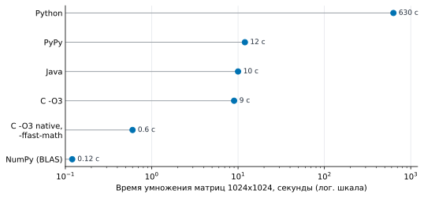
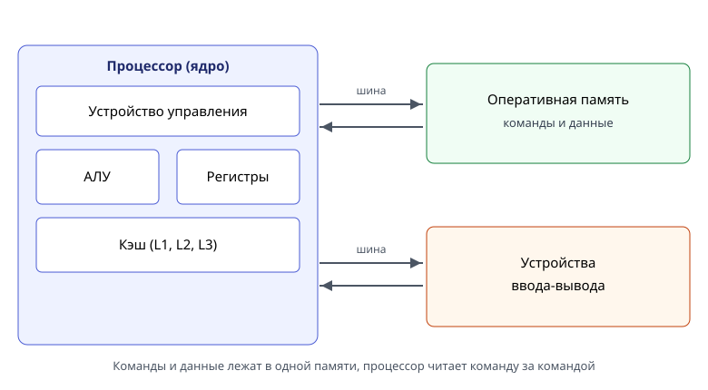
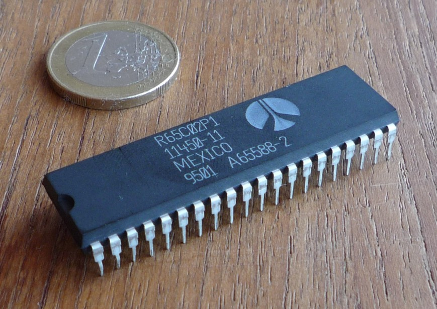
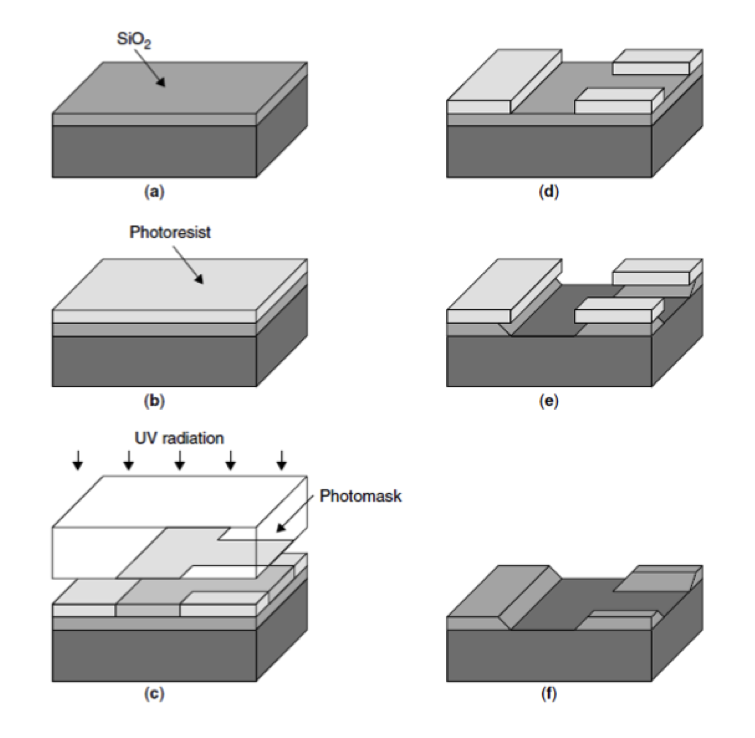
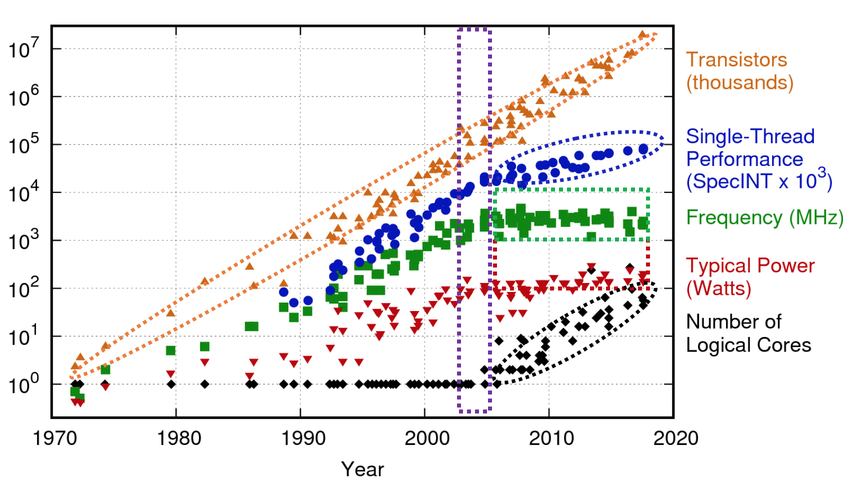
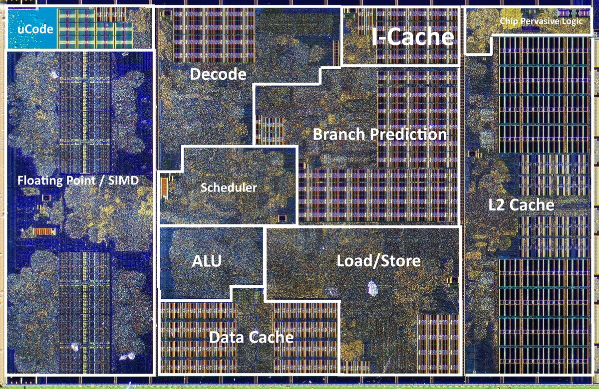

# 1. Производительность и железо

<figure class="epigraph">
  <blockquote>
    <p>Программисты тратят огромное количество времени, думая о скорости некритичных частей своих программ. Мы должны забыть о мелкой эффективности примерно в 97% случаев: преждевременная оптимизация - корень всех зол. Но мы не должны упускать наши возможности в критических 3%.</p>
  </blockquote>
  <figcaption>
    Дональд Кнут, 1974
  </figcaption>
</figure>

Обычно цитату Кнута обрывают на словах "корень всех зол" и используют как разрешение не думать о скорости вообще. Но вторая половина важнее: есть 3% кода, где скорость решает все. Этот курс - про эти 3%. Мы научимся находить их, понимать, почему они медленные, и ускорять их в разы, а иногда в сотни раз.

Чтобы это получалось, нужно знать, как устроен компьютер, на котором работает программа. Не *вообще*, а очень конкретно: что происходит с инструкцией внутри процессора, сколько стоит обращение к памяти, почему одна и та же формула может считаться в десять раз быстрее, если переставить два цикла.

---

## Одна задача - пять ответов

Начнем с эксперимента. Возьмем самую обычную вычислительную задачу - умножение двух квадратных матриц $n \times n$:

$$
c_{ij} = \sum_{k=0}^{n-1} a_{ik} \, b_{kj}
$$

Каждый элемент результата - это скалярное произведение строки $a$ на столбец $b$. Всего $n^2$ элементов, на каждый $n$ умножений и $n$ сложений, итого $2n^3$ арифметических операций. Алгоритм прямолинейный, сложность $O(n^3)$, и никаких хитростей в нем нет.

На Python это три вложенных цикла:

```python
for i in range(n):
    for j in range(n):
        for k in range(n):
            c[i][j] += a[i][k] * b[k][j]
```

Тот же алгоритм можно записать на Java, на C, собрать с разными флагами компилятора или вообще вызвать готовую библиотеку. Алгоритм везде один и тот же - три вложенных цикла, $2n^3$ операций. Вот что получается для $n = 1024$ (один и тот же компьютер):

| Версия | Время | Ускорение относительно Python |
|---|---|---|
| Python, три цикла | ~630 с | 1 |
| PyPy (Python с JIT-компиляцией) | ~12 с | ~50 |
| Java | ~10 с | ~63 |
| C, `gcc -O3` | ~9 с | ~70 |
| C, `gcc -O3 -march=native -ffast-math` | ~0.6 с | ~1000 |
| NumPy (библиотека BLAS) | ~0.12 с | ~5000 |

Числа в таблице - не норматив и не *чистое* сравнение языков. Они получены на одной машине при $n = 1024$, и это один запуск, а не медиана. NumPy вызывает BLAS, который может задействовать несколько ядер, а Python тратит время на интерпретатор. Сравнение показывает размах, а не вклад одного языка; на другой машине числа будут другими.

Ту же картину удобно увидеть на графике:

<figure class="figure" markdown="1">
{ width="720" }
<figcaption>Время умножения матриц 1024x1024 на одном компьютере, логарифмическая шкала. Разница между Python и NumPy - больше 5000 раз. Источник данных: замеры автора.</figcaption>
</figure>

В таблице и на графике - только два порядка из шести. Полный набор - `ijk`, `ikj`, `jik`, `jki`, `kij`, `kji`; в задании 1 вы измерите все шесть на нескольких размерах и построите зависимость времени от $n$.

### Алгоритмические улучшения: Штрассен

Порядок циклов и флаги компилятора меняют скорость, но не число арифметических операций: у всех трех циклов $2n^3$ умножений и сложений. [Алгоритм Штрассена (1969)](https://link.springer.com/article/10.1007/BF02165411) уменьшает саму работу. Для блоков $2 \times 2$ он обходится семью умножениями вместо восьми:

$$
\begin{aligned}
M_1 &= (A_{11}+A_{22})(B_{11}+B_{22}),\\
M_2 &= (A_{21}+A_{22})B_{11},\\
M_3 &= A_{11}(B_{12}-B_{22}),\\
M_4 &= A_{22}(B_{21}-B_{11}),\\
M_5 &= (A_{11}+A_{12})B_{22},\\
M_6 &= (A_{21}-A_{11})(B_{11}+B_{12}),\\
M_7 &= (A_{12}-A_{22})(B_{21}+B_{22}).
\end{aligned}
$$

Блоки результата собираются из $M_i$:

$$
\begin{aligned}
C_{11} &= M_1+M_4-M_5+M_7, & C_{12} &= M_3+M_5,\\
C_{21} &= M_2+M_4, & C_{22} &= M_1-M_2+M_3+M_6.
\end{aligned}
$$

Рекурсия дает $T(n)=7T(n/2)+O(n^2)$, то есть $O(n^{\log_2 7}) \approx O(n^{2.807})$ вместо $O(n^3)$. Выигрыш может появиться на больших матрицах: сложений и обращений к памяти становится больше, а на маленьких блоках рекурсия не окупается. На практике порог зависит от реализации и машины. Поэтому в реализации нужен базовый случай: при $n \le 64$ можно считать обычным `ijk`.

Матрицы должны быть квадратными, а $n$ - степенью двойки. Для других размеров матрицу дополняют нулями до ближайшей степени двойки. Порог, начиная с которого работает обычное умножение, - параметр для настройки. Числа с плавающей точкой при другом порядке сложений могут отличаться в последних битах, поэтому результат сравнивают с обычным умножением с допуском.

Реализуйте алгоритм самостоятельно в задании 1 и сравните с `ijk` и `ikj`: на маленьких матрицах накладные расходы рекурсии могут съесть выигрыш, на больших - сказаться меньшее число умножений.

Разница между первой и последней строкой - **пять тысяч раз**. При этом асимптотика у всех строк одинаковая: $O(n^3)$.

На ноутбуке, на котором писался этот текст (Intel Raptor Lake, GCC 15, Python 3.14), картина та же, хотя цифры другие:

| Версия | Время для $n = 1024$ | GFLOPS |
|---|---|---|
| Python, три цикла | ~85 с (оценка по $n = 256$) | 0.025 |
| C `ijk`, `-O0` | 4.3 с | 0.5 |
| C `ijk`, `-O2` | 1.0 с | 2.1 |
| C `ikj`, `-O2` | 0.20 с | 11.0 |
| C `ikj`, `-O3 -march=native` | 0.135 с | 15.9 |

Свежий Python заметно быстрее приведенных чисел, но разрыв с C все равно больше 600 раз. А обратите внимание на строки `ijk` и `ikj`: это одна и та же программа, в которой поменяли местами два вложенных цикла. Число операций не изменилось ни на одну, а время уменьшилось в пять раз. Почему - разберем в модулях 9-11, когда будем говорить о кэше. Пока просто запомните: **порядок обращений к памяти может стоить больше, чем сама арифметика**.

### Почему Python такой медленный

Не потому, что *Python плохой*. Python - интерпретируемый язык с динамической типизацией, и за удобство он платит работой во время выполнения. Когда интерпретатор CPython выполняет строку `c[i][j] += a[i][k] * b[k][j]`, он:

1. читает байт-код и решает, какую операцию выполнять;
2. достает `a[i]` - это объект-список, проверяет, что индекс в границах;
3. достает `a[i][k]` - это объект `float`, где-то в памяти;
4. то же для `b[k][j]`;
5. проверяет типы обоих операндов, находит функцию умножения для пары `float * float`;
6. создает **новый объект** `float` для результата (выделяет память!);
7. повторяет все то же для сложения;
8. уменьшает счетчики ссылок у временных объектов и, возможно, освобождает их.

Само умножение двух чисел занимает в процессоре около одного такта. Все остальное - десятки и сотни тактов накладных расходов. Получается, что больше 99% времени процессор занят не умножением матриц, а обслуживанием интерпретатора.

Java и PyPy компилируют горячий код в машинные инструкции во время работы (JIT-компиляция), и накладные расходы почти исчезают. C компилируется в машинный код заранее - и сразу становится в десятки раз быстрее Python.

### Три типа языков

С точки зрения того, как код доходит до процессора, языков три:

| Тип | Примеры | Что происходит |
|---|---|---|
| интерпретируемые | Python, JavaScript, Ruby | интерпретатор разбирает и выполняет операции во время работы |
| компилируемые с рантаймом | Java, C#, Erlang | компилируются в байт-код, виртуальная машина исполняет его и компилирует горячие места (JIT) |
| компилируемые в машинный код | C, C++, Rust, Go | компилятор заранее делает машинный код |

Разница видна в тактах на одно умножение. На машине из примера Python тратит около 820 тактов: 630 секунд на 1.4 ГГц - это почти $10^{12}$ тактов, а умножений в матрице $1024^3 \approx 10^9$. Java после JIT укладывается примерно в 13 тактов - в 63 раза быстрее. C без флагов - 9 секунд, а с `-march=native -ffast-math` - 0.6 секунды.

Дело не в том, что *C лучше*. Интерпретатор платит за гибкость на каждом шаге, а компилятор - один раз, заранее. Язык - это инструмент, который отнимает часть контроля над железом в обмен на удобства; C возвращает контроль, но не гарантирует скорость сам по себе.

### Почему C тоже бывает медленным

Самое интересное начинается дальше. Версия на C с `-O3` работает 9 секунд, а та же программа с флагами `-march=native -ffast-math` - 0.6 секунды. Исходный код не изменился ни на символ. Что произошло?

- `-march=native` разрешает компилятору использовать **все** инструкции процессора, на котором идет сборка, в том числе векторные (AVX2, AVX-512). Одна векторная инструкция складывает или умножает сразу 4, 8 или 16 чисел. Без этого флага компилятор генерирует код для *среднего* x86-64 образца 2003 года, где векторы короче.
- `-ffast-math` разрешает переставлять операции с плавающей точкой. Строго по стандарту IEEE 754 $(a + b) + c \ne a + (b + c)$ (почему - модуль 4), и компилятор не имеет права менять порядок сложений в сумме. С этим флагом имеет - и тогда может считать несколько сумм параллельно.

А NumPy вызывает библиотеку BLAS, которую десятилетиями оптимизировали вручную под каждый процессор: блоки под размеры кэшей, векторные инструкции, несколько ядер. Такую версию вы напишете сами в итоговом проекте курса ([задание 19](../tasks/19-gemm.md)) - примерно на 40 строках C. NumPy и BLAS могут использовать несколько ядер, поэтому сравнение с ними не является сравнением одного потока с одним потоком.

> **Проверьте себя.** Сколько умножений делает умножение матриц $1024 \times 1024$? Если процессор работает на частоте 3 ГГц и выполняет одно умножение за такт, сколько секунд займут только умножения? Сравните с 630 секундами Python и 0.12 секунды NumPy. Что из этого следует про NumPy?

### Сколько операций в секунду

Полезно помнить порядок величин: *операций в секунду* сильно зависит от того, что считать операцией.

| Что делает код | Порядок операций в секунду |
|---|---|
| перебор связного списка (каждое обращение - промах) | $10^7$ |
| ветвящийся скалярный код | $10^8$ |
| безветвленный скалярный код | $10^9$ |
| векторный код, упирающийся в память | $10^{10}$ |
| линейная алгебра на одном ядре | $10^{11}$ |

Это не точные числа, а ориентир: между соседними строками - порядок, и объясняется он не языком, а тем, насколько хорошо код использует конвейер, кэш и векторы. В задании 1 вы измерите свою строку этой таблицы.

## Как устроен компьютер

Любая программа, на каком бы языке она ни была написана, в конце концов превращается в последовательность **команд** - инструкций, которые процессор читает из памяти и выполняет одну за другой. Это идея фон Неймана: команды и данные лежат в одной памяти, а процессор умеет немногое - прочитать команду, прочитать или записать данные и перейти к другой команде.

<figure class="figure" markdown="1">

<figcaption>Процессор, память и устройства ввода-вывода, соединенные шинами. Команды и данные лежат в одной памяти.</figcaption>
</figure>

Внутри процессора:

- **устройство управления** читает команду, декодирует ее и решает, что делать дальше;
- **АЛУ** (арифметико-логическое устройство) выполняет операции над числами и битами;
- **регистры** - несколько десятков ячеек по 8 байт; это самая быстрая память, но ее очень мало;
- **кэш** - несколько уровней памяти рядом с ядром, которые прячут медленную оперативную память.

Память образует иерархию: регистры, L1, L2, L3, оперативная память, диск. Чем дальше от процессора, тем больше объем и тем выше задержка. В модуле 9 мы измерим эту иерархию на своей машине, а пока важно запомнить главное:

**быстрая память маленькая, большая память медленная**.

Команда состоит из **кода операции** и **операндов**: что сделать и с чем. Например, `add x5, x6, x7` складывает содержимое регистров x6 и x7 и кладет результат в x5. Есть команды арифметики, загрузки и сохранения, переходы и вызовы функций. Программа на C превращается в такие команды компилятором - это видно в Godbolt, и мы будем этим пользоваться.

Почему это важно для производительности: процессор может выполнять команды не по одной, а конвейером и параллельно (модули 6 и 14-15), но только если команды независимы. Память отдает данные быстро, только если обращения локальны (модули 9-11). Все оптимизации курса - это способы дать железу такие команды.

## Откуда взялась производительность

Чтобы понять, почему современный процессор так чувствителен к тому, как написан код, нужно вернуться на шестьдесят лет назад.

### Микросхемы и фотолитография

Суперкомпьютеры 1960-х были не столько медленными, сколько огромными, сложными и дорогими: их собирали вручную из тысяч отдельных компонентов. Переворот произвела **микросхема** - целая электрическая схема на одном кристалле кремния. То, что в 1965 году было шкафом за миллионы долларов, в 1975 году помещалось на кристалл $4 \times 4$ мм за 25 долларов (процессор MOS 6502 - на нем работали Apple II и Commodore 64).

<figure class="figure" markdown="1">
{ width="340" }
<figcaption>MOS 6502: 4 x 4 мм, 25 долларов, 1975 год. На нем работали Apple II и Commodore 64. Источник: S. Slotin, открытые материалы.</figcaption>
</figure>

Микросхемы *печатают* на пластине кремния методом **фотолитографии**: пластину покрывают светочувствительным слоем, засвечивают через маску с рисунком схемы, вытравливают засвеченные участки - и так несколько десятков раз. Ключевая деталь: рисунок проецируется через систему линз и уменьшается. Сделали линзы точнее - получили те же транзисторы, только меньше. Это дало понятный путь к росту производительности: просто уменьшать.

<figure class="figure" markdown="1">

<figcaption>Фотолитография: рисунок схемы проецируется через маску, уменьшается объективом и засвечивает слой на пластине. Источник: S. Slotin, открытые материалы.</figcaption>
</figure>

### Масштабирование Деннарда и закон Мура

Что происходит, если уменьшить все размеры транзистора на 30%? Наблюдение Роберта Деннарда (1974):

- плотность транзисторов растет вдвое: $0.7^2 \approx 0.5$ площади на транзистор;
- частота растет на 40%: $1 / 0.7 \approx 1.4$ - маленький транзистор переключается быстрее;
- **плотность мощности остается прежней**: меньше транзисторы, меньше напряжение, меньше ток.

То есть каждое новое поколение технологии дает в 2 раза больше транзисторов и на 40% большую частоту при той же цене и том же нагреве. Гордон Мур (Intel) еще в 1965-1975 годах заметил, что число транзисторов в процессоре удваивается каждые два года. Это наблюдение назвали **законом Мура**.

Кстати, современные *3 нм* и *5 нм* в названиях процессоров - уже маркетинговые числа, а не размер транзистора: после замедления закона Мура техпроцессы перестали означать реальные нанометры.

Оба *закона* - не законы физики, а наблюдения. Для программиста они означали одно: **не нужно ничего делать**. Купил новый компьютер через два года - старая программа работает почти вдвое быстрее. Тридцать лет подряд.

### Конец бесплатного обеда

Около 2005 года масштабирование Деннарда остановилось. Транзисторы стали настолько маленькими, что начались **токи утечки**: электроны просачиваются туда, куда не должны, схема греется даже без работы. Чтобы транзисторы надежно переключались, напряжение больше нельзя снижать, а значит, рост частоты упирается в тепло. Процессор - это, с точки зрения физики, очень эффективный нагреватель, и с кристалла размером в сантиметр больше примерно 100-200 Вт не отвести.

<figure class="figure" markdown="1">
{ width="720" }
<figcaption>Транзисторы, частота, однопоточная производительность, мощность и число ядер по годам. Частота перестала расти около 2005 года, а транзисторы и ядра продолжают. Источник: S. Slotin, открытые материалы.</figcaption>
</figure>

А закон Мура продолжает работать: транзисторов по-прежнему все больше. Куда их тратить, если не в частоту? Ответ: в **параллелизм**. Процессор не может делать каждый шаг быстрее, поэтому он учится делать больше шагов одновременно.

Херб Саттер назвал это в 2005 году *The Free Lunch Is Over* - бесплатный обед закончился. Старая программа на новом процессоре больше не ускоряется сама. Ускоряется только программа, которая умеет использовать параллелизм.

> **Проверьте себя.** Почему производители не могут просто поднять частоту до 10 ГГц, охладив процессор жидким азотом? (Подсказка: что нужно для работы обычного ноутбука и сервера в стойке, где их тысячи?)

## Куда уходят транзисторы

Вот основные способы, которыми современный процессор превращает лишние транзисторы в скорость. Каждый из них - отдельный модуль курса.

| Механизм | Что делает | Модуль |
|---|---|---|
| конвейер | пока одна инструкция выполняется, следующие уже читаются и декодируются | 6 |
| предсказание переходов | процессор угадывает, куда пойдет `if`, и выполняет код заранее | 7 |
| суперскалярность и внеочередное исполнение | несколько независимых инструкций за такт, не обязательно в порядке программы | 6 |
| иерархия кэшей | маленькая быстрая память рядом с ядром прячет медленную DRAM | 9-11 |
| векторные инструкции (SIMD) | одна инструкция обрабатывает 4, 8, 16 чисел | 14-15 |
| несколько ядер | несколько независимых процессоров на одном кристалле | 18 |

<figure class="figure" markdown="1">
{ width="460" }
<figcaption>Кристалл современного процессора (ядро AMD Zen, около 1.4 млрд транзисторов). Источник: S. Slotin, открытые материалы.</figcaption>
</figure>

Их можно представить как уровни параллелизма:

<figure class="figure" markdown="1">
{ width="620" }
{ width="620" }
<figcaption>Четыре вида параллелизма: TLP, DLP, ILP и MLP. Одна и та же программа может использовать их вместе.</figcaption>
</figure>

За пределами одного кристалла те же идеи продолжаются: специализированные ускорители (ASIC, FPGA) жертвуют универсальностью ради эффективности, а несколько чипов в машине или стойке дают еще один уровень параллелизма. В курсе мы в основном остаемся внутри одного ядра, но принципы - независимость, локальность, векторизация - те же.

Главная мысль: **все эти механизмы работают только при определенных условиях**. Конвейер работает, пока инструкции независимы. Предсказатель работает, пока ветвления предсказуемы. Кэш работает, пока обращения к памяти локальны. SIMD работает, пока данные лежат подряд и обрабатываются одинаково. Ядра работают, пока потоки не мешают друг другу.

Код, который нарушает эти условия, может работать в десятки раз медленнее, чем мог бы. И компилятор далеко не всегда может это исправить сам: он не знает, какие у вас данные и как вы к ним обращаетесь. Поэтому программисту нужно понимать устройство процессора - не чтобы писать на ассемблере, а чтобы писать на C (и на любом другом языке) так, чтобы железо могло работать.

## После конца масштабирования

С 2005 года частота процессоров почти не растет: Dennard scaling закончился, и транзисторы больше не становятся одновременно быстрее и экономичнее. Транзисторов по-прежнему много, но их приходится тратить на параллелизм, кэши и специализированные блоки, а не на повышение тактовой частоты. Поэтому рост однопоточной производительности замедлился, и архитектура ищет другие пути.

Их несколько, и они не заменяют друг друга. **Специализация** (GPU, TPU, FPGA, NPU) дает лучшую эффективность на своем классе задач, но сужает область применения. **Чиплеты и wafer-scale** позволяют строить большие системы из меньших кристаллов, но добавляют стоимость межсоединений. **Открытые ISA**, прежде всего RISC-V, снижают барьер для собственных процессоров. **Memory-centric computing** пытается приблизить вычисления к памяти, потому что перемещение данных стало дороже арифметики. **Аппаратно-программное проектирование** и безопасность становятся частью архитектуры, а не надстройкой.

Общая закономерность: выигрыш теперь дают не только новые транзисторы, но и удачное разделение работы между железом и программой. Критериев у такого решения несколько - производительность, энергия, стоимость и масштабируемость, - и они часто конфликтуют. В обзорах ниже направления описаны по-разному; читайте их как карту вариантов и аргументов, а не как доказанный прогноз.

## Железное уравнение производительности

Как рассуждать о времени работы программы? Удобная формула из учебника Хеннесси и Паттерсона:

$$
T = N_{instr} \cdot CPI \cdot \frac{1}{f}
$$

- $N_{instr}$ - сколько инструкций процессор выполнил;
- $CPI$ (cycles per instruction) - сколько тактов в среднем уходит на одну инструкцию;
- $f$ - тактовая частота.

Часто вместо $CPI$ говорят про обратную величину $IPC = 1 / CPI$ - сколько инструкций выполняется за такт.

Пример. Программа выполнила $4 \cdot 10^9$ инструкций на процессоре с частотой 3 ГГц и $IPC = 2$:

$$
T = \frac{4 \cdot 10^9}{2 \cdot 3 \cdot 10^9} \approx 0.67 \text{ с}
$$

Если та же программа из-за промахов кэша работает с $IPC = 0.5$, время вырастет вчетверо: 2.7 секунды. Число инструкций то же, частота та же - а разница в 4 раза.

Что влияет на каждый множитель:

| Множитель | От чего зависит | Как на него влиять | Где в курсе |
|---|---|---|---|
| $N_{instr}$ | алгоритм, компилятор, ISA, векторизация | лучший алгоритм, флаги компилятора, SIMD | 02, 03, 09, 14-16 |
| $CPI$ | зависимости, ветвления, промахи кэша | порядок операций, branchless-код, раскладка данных | 07, 08, 10-13 |
| $f$ | процессор, температура, turbo | почти никак | - |

Современное ядро умеет выполнять 4-6 инструкций за такт. Реальные программы часто получают $IPC$ меньше 1. Между этими числами - пространство для оптимизации, и именно его мы будем осваивать.

## Сколько это в *попугаях*: GFLOPS

Чтобы сравнивать вычислительные программы между собой и с возможностями железа, используют **FLOPS** - число операций с плавающей точкой в секунду. Для умножения матриц:

$$
\text{GFLOPS} = \frac{2 n^3}{t \cdot 10^9}
$$

Посчитаем для $n = 1024$: $2 n^3 \approx 2.15 \cdot 10^9$ операций.

- Python, 630 с: $2.15 \cdot 10^9 / 630 \approx 3.4 \cdot 10^6$ операций в секунду, то есть **0.0034 GFLOPS**.
- NumPy, 0.12 с: около **18 GFLOPS**.

А сколько может процессор? Пиковая производительность одного ядра:

$$
P_{peak} = f \cdot (\text{FMA-блоков}) \cdot (\text{чисел в векторе}) \cdot 2
$$

Для ядра на 3 ГГц с двумя блоками FMA (умножение и сложение за одну инструкцию) и векторами AVX2 по 8 чисел `float`: $3 \cdot 2 \cdot 8 \cdot 2 = 96$ GFLOPS. Наивный Python использует **несколько тысячных процента** возможностей одного ядра, а ядер в процессоре 8-16.

Это не повод писать все на ассемблере. Это повод понимать, где теряется скорость, и уметь ее вернуть там, где она важна.

## Когда оптимизировать

Вернемся к Кнуту. Оптимизация стоит времени программиста, усложняет код и может вносить ошибки. Поэтому есть простой порядок действий:

1. **Сначала правильность.** Быстрая неправильная программа никому не нужна.
2. **Потом измерение.** Найти, где программа тратит время. Интуиция здесь почти всегда ошибается: узкое место оказывается не там, где вы думали. Инструменты для этого - в модуле 5.
3. **Потом алгоритм.** Переход от $O(n^2)$ к $O(n \log n)$ обычно дает больше, чем любые трюки.
4. **И только потом железо.** Раскладка данных, порядок циклов, векторизация, потоки - то, чему посвящен курс.

На шаге 4 выигрыш тоже бывает огромным - в 10-100 раз, как мы видели на умножении матриц. Но браться за него стоит тогда, когда вы знаете, что этот код и есть те самые 3%.

## Итоги

- Одна и та же программа с одним и тем же алгоритмом может работать в тысячи раз быстрее или медленнее в зависимости от языка, компилятора, флагов и порядка обращений к памяти.
- Частота процессоров перестала расти около 2005 года. Рост производительности теперь идет за счет параллелизма на всех уровнях, и программа должна уметь им пользоваться.
- Время работы $T = N_{instr} \cdot CPI / f$. Курс посвящен в основном $CPI$ и $N_{instr}$.
- Оптимизировать нужно то, что измерено как узкое место, и в правильном порядке: правильность, измерение, алгоритм, железо.
- Язык задает, сколько контроля над железом у вас есть: интерпретатор платит за гибкость на каждом шаге, компилятор - один раз. Но и C не гарантирует скорость сам по себе.

## Что почитать

- [C. Leiserson et al., There's Plenty of Room at the Top: What Will Drive Computer Performance after Moore's Law? Science, 2020.](https://gwern.net/doc/cs/hardware/2020-leiserson.pdf) Те же умножения матриц, но с ускорением до 60000 раз на всех ядрах; хорошая отправная точка про алгоритмы, компиляторы и параллелизм.
- [J. Hennessy, D. Patterson, A New Golden Age for Computer Architecture. Communications of the ACM, 2019.](https://cacm.acm.org/research/a-new-golden-age-for-computer-architecture/) Продолжение той же линии: конец Dennard scaling, специализированные архитектуры, открытые ISA, безопасность и agile-проектирование. Авторы называют новым золотым веком именно специализацию, а не рост частоты.
- [D. Etiemble, Technologies and Computing Paradigms: Beyond Moore's Law? arXiv:2206.03201, 2022.](https://arxiv.org/abs/2206.03201) Исторический обзор того, что сработало и что не сработало, когда технологические стены уже появлялись. Полезен как список критериев для оценки новых идей: производительность, энергия, стоимость, масштабируемость.
- [O. Mutlu et al., Memory-Centric Computing: Solving Computing's Memory Problem. arXiv:2505.00458.](https://arxiv.org/abs/2505.00458) Почему перемещение данных стало главным ограничением и какие есть варианты processing-in-memory и near-memory. Хорошее дополнение к модулям про кэш и память.
- [L. Ceze, M. Hill, T. Wenisch и другие материалы Arch2030 / CRA-CCC.](https://cra.org/ccc/visioning/visioning-activities/arch2030/) Позиционные статьи о повестке после классического масштабирования: гетерогенность, специализация, новые устройства и совместное проектирование железа и софта. См. также [Conte et al., arXiv:2101.01284](https://arxiv.org/abs/2101.01284).
- [Evolution, Challenges, and Optimization in Computer Architecture: The Role of Reconfigurable Systems. arXiv:2412.19234.](https://arxiv.org/abs/2412.19234) Обзор перехода от одноядерных процессоров к многоядерным, причины power wall и движения к ускорителям и реконфигурируемым системам.

- [H. Sutter, The Free Lunch Is Over: A Fundamental Turn Toward Concurrency in Software, 2005.](https://www.cs.helsinki.fi/u/kerola/rio/papers/sutter_2005.pdf) Почему после роста частоты программисту приходится думать о параллелизме.


---

Задание к модулю: [Python, C и Godbolt](../tasks/01-python-godbolt.md).
