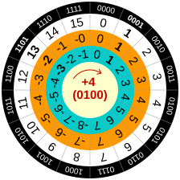
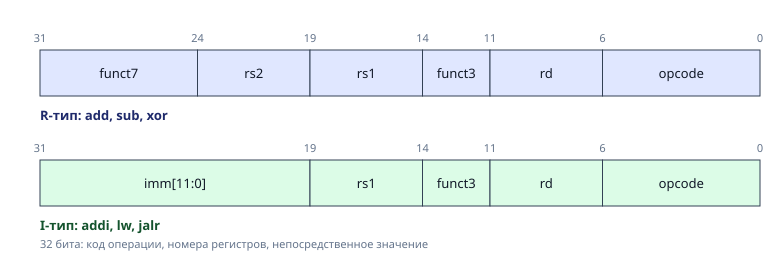

# 2. Целые числа и битовые операции

<figure class="epigraph">
  <blockquote>
    <p>Существует 10 типов людей: те, кто понимает двоичную систему счисления, и те, кто не понимает.</p>
  </blockquote>
  <figcaption>
    Народная мудрость программистов
  </figcaption>
</figure>

В предыдущем модуле мы увидели, что скорость программы зависит от того, насколько хорошо она ложится на железо. Теперь спустимся на самый нижний уровень: как процессор хранит целые числа и что он умеет с ними делать.

Процессор не знает, что такое *число*. Он знает **регистры** фиксированной ширины - 32 или 64 бита - и операции над этими битами. Знак, переполнение, порядок байтов в памяти - все это соглашения, которые договорились соблюдать компилятор, процессор и программист. Кто понимает эти соглашения, тот пишет код без неопределенного поведения, умеет заменять медленные операции быстрыми и понимает, почему `abs(x)` иногда возвращает отрицательное число.

> **Как воспроизвести примеры.** Все примеры с ассемблером собраны в Godbolt. Для x86-64 выберите `x86-64 gcc` и включите `-masm=intel`, для RISC-V - `RISC-V (64-bits) gcc` и флаг `-march=rv64gc`. Уровень оптимизации - `-O2`. `Compile to binary` показывает байты, `Execute` запускает `main`. Время на Godbolt не измеряйте: машина общая, нагрузка неизвестна.

---

## Системы счисления

Компьютер хранит все в двоичном виде, но записывать числа нулями и единицами неудобно: ошибку в длинной строке не заметить. Поэтому в программах, ассемблере и документации используют **шестнадцатеричную** запись: одна цифра - ровно 4 бита, байт - ровно две цифры.

| Десятичное | Двоичное | Шестнадцатеричное |
|---|---|---|
| 0 | 0000 | 0 |
| 1 | 0001 | 1 |
| 2 | 0010 | 2 |
| 3 | 0011 | 3 |
| 4 | 0100 | 4 |
| 5 | 0101 | 5 |
| 6 | 0110 | 6 |
| 7 | 0111 | 7 |
| 8 | 1000 | 8 |
| 9 | 1001 | 9 |
| 10 | 1010 | A |
| 11 | 1011 | B |
| 12 | 1100 | C |
| 13 | 1101 | D |
| 14 | 1110 | E |
| 15 | 1111 | F |
| 16 | 1 0000 | 10 |

Правила перевода короткие: двоичное в шестнадцатеричное переводят группами по четыре бита, десятичное в любое - делением на основание с остатками, а обратно - умножением цифр на степени основания.

В Python: `bin(42)` дает `'0b101010'`, `hex(42)` - `'0x2a'`, `int('2a', 16)` возвращает 42. В C: `0x2a`, `0b101010` (C23 и GCC), а `052` - это восьмеричное число, поэтому ведущий ноль в C ставят осознанно.

Шестнадцатеричная запись встречается в адресах, масках, дампах памяти и в ассемблере - везде, где важно видеть биты, а не десятичное значение.

## Биты, байты, слова

**Бит** - одна двоичная цифра, 0 или 1. Физически это напряжение на проводе или заряд в ячейке памяти. **Байт** - 8 бит, минимальная адресуемая единица памяти: у каждого байта есть свой адрес, а у отдельного бита - нет.

**Машинное слово** - столько бит, сколько процессор обрабатывает одной инструкцией и хранит в одном регистре общего назначения. У x86-64, AArch64 и RV64 это 64 бита. Отсюда и название *64-битный процессор*: регистры по 64 бита и адреса памяти по 64 бита.

С терминами `WORD` и `DWORD` есть путаница, потому что они зависят от контекста. В документации x86 и Windows `WORD` - это 16 бит, `DWORD` (double word) - 32 бита, `QWORD` (quad word) - 64 бита. Это исторические имена, а не размер машинного слова x86-64: там машинное слово 64 бита, но `DWORD` все равно 32.

| Термин | Биты | Где встречается |
|---|---:|---|
| `BYTE` | 8 | x86, Windows |
| `WORD` | 16 | x86, Windows |
| `DWORD` | 32 | x86, Windows |
| `QWORD` | 64 | x86-64, Windows |
| машинное слово | 32 или 64 | зависит от архитектуры |
| `.word` | 32 | GNU as для RISC-V и ARM |
| `.dword` | 64 | GNU as для RISC-V |

В C не используйте `WORD` и `DWORD` для переносимого кода: берите `uint16_t`, `uint32_t`, `uint64_t` из `<stdint.h>`. Тогда размер не зависит от платформы и от того, что автор заголовочного файла назвал словом.

Сколько бит занимает `int`? Ответ *4 байта* верен для всех машин курса, но не потому, что так сказано в стандарте C. Стандарт гарантирует только минимум: `int` не меньше 16 бит, `long` не меньше 32. Реальные размеры задает **модель данных** платформы:

| Тип C | LP64 (Linux x86-64, AArch64, RV64) | LLP64 (Windows x64) |
|---|---|---|
| `char` | 8 | 8 |
| `short` | 16 | 16 |
| `int` | 32 | 32 |
| `long` | 64 | **32** |
| `long long` | 64 | 64 |
| указатель | 64 | 64 |

Код, в котором `long` используется как *64-битное целое*, тихо сломается на Windows. Поэтому в курсе, когда важен размер, мы пишем типы из `<stdint.h>`: `int8_t`, `uint16_t`, `int32_t`, `uint64_t`. Их размер одинаков везде. В ассемблере x86 те же размеры называют `byte`, `word`, `dword` и `qword` - 8, 16, 32 и 64 бита. В GNU as для RISC-V `word` - это 32 бита, а `dword` - 64; поэтому в ассемблере всегда смотрите, для какой платформы он написан.

## Беззнаковые числа

Беззнаковое $n$-битное число - это обычная двоичная запись:

$$
x = \sum_{i=0}^{n-1} b_i \cdot 2^i, \qquad 0 \le x \le 2^n - 1
$$

Например:

$$
5 = 101_2 = 4 + 1, \qquad 42 = 101010_2 = 32 + 8 + 2, \qquad 256 = 100000000_2 = 2^8
$$

Двоичная запись длинная, поэтому в коде и в отладчике почти всегда используют **шестнадцатеричную**: одна hex-цифра - ровно 4 бита, байт - ровно две цифры. Переводить между ними можно по четверкам бит, без всякой арифметики:

```text
 двоичная:   1101 0110 0010 1010
 hex:           D    6    2    A      ->  0xD62A
```

В C: `0x2A` - шестнадцатеричная запись, `052` - восьмеричная (осторожно с ведущим нулем!), `0b101010` - двоичная (расширение GCC и Clang, в стандарте с C23).

### Переполнение - это арифметика по модулю

Что будет, если результат не помещается в $n$ бит? Для беззнаковых типов ответ простой и определен стандартом: лишние старшие биты отбрасываются. Это в точности арифметика по модулю $2^n$:

$$
256 \equiv 0 \pmod{2^8}, \qquad 2021 \equiv 229 \pmod{2^8}, \qquad -42 \equiv 256 - 42 = 214 \pmod{2^8}
$$

```c
uint8_t x = 250;
x += 10;           // 260 mod 256 = 4
uint32_t y = 0;
y -= 1;            // 4294967295 = 2^32 - 1
```

Процессору это ничего не стоит: сумматор просто не хранит перенос из старшего разряда. Этим пользуются хеш-функции, генераторы случайных чисел и криптография - там нужна именно арифметика по модулю $2^{32}$ или $2^{64}$.

### Упражнение. Перевод в уме

Переведите без калькулятора, затем проверьте через `printf("%x %u\n", ...)`:

1. `0xFF`, `0x100`, `0x2A` - в десятичную.
2. 200, 1000, 65535 - в шестнадцатеричную.
3. `0b11010110` - в шестнадцатеричную и десятичную.
4. Чему равно `(uint8_t)(200 + 100)`? А `(uint16_t)(200 + 100)`?

## Модульная арифметика

Говорят, что $a \equiv b \pmod{m}$, если $a - b$ делится на $m$ без остатка. Остаток всегда можно взять в диапазоне $0 \le r < m$; например, $17 \equiv 2 \pmod 5$, а $-42 \equiv 214 \pmod{256}$.

Сложение и умножение можно делать до или после взятия остатка:

$$
(a + b) \bmod m = ((a \bmod m) + (b \bmod m)) \bmod m,
$$

$$
(a \cdot b) \bmod m = ((a \bmod m) \cdot (b \bmod m)) \bmod m.
$$

Для беззнаковых чисел по модулю $2^n$ это бесплатно: процессор просто отбрасывает перенос из старшего разряда. Поэтому `uint32_t` - арифметика по модулю $2^{32}$, а `uint64_t` - по модулю $2^{64}$.

С `%` в C есть тонкость: знак остатка совпадает со знаком делимого, поэтому `-7 % 3 == -1`, а не `2`. Если нужен неотрицательный остаток, его нормализуют:

```c
int mod(int x, int m) {
    int r = x % m;
    return r < 0 ? r + m : r;
}
```

Деление по модулю - это умножение на обратный элемент. Обратный $a^{-1}$ существует, только если $\gcd(a, m) = 1$; для простого $m$ и $a \ne 0$ он есть всегда, и по малой теореме Ферма $a^{-1} \equiv a^{m-2} \pmod m$. Для составного $m$ обратный ищут расширенным алгоритмом Евклида. Быстрое возведение в степень:

```c
uint64_t mod_pow(uint64_t a, uint64_t e, uint64_t m) {
    uint64_t r = 1 % m;
    a %= m;
    while (e) {
        if (e & 1) r = (__uint128_t)r * a % m;
        a = (__uint128_t)a * a % m;
        e >>= 1;
    }
    return r;
}
```

В курсе модульная арифметика встретится в хеш-функциях, генераторах случайных чисел, криптографии и при делении на константу.

`__uint128_t` в примере - расширение GCC и Clang, а не стандарт C. В переносимом коде для умножения по модулю нужен либо более широкий тип, либо умножение с проверкой переполнения.

## Отрицательные числа: дополнительный код

Как хранить отрицательные числа? Первое, что приходит в голову, - отдать старший бит под знак, как у чисел с плавающей точкой. Но тогда появляются два нуля ($+0$ и $-0$), а сложение положительного с отрицательным требует отдельной схемы. Инженеры поступили хитрее - из лени: они хотели переиспользовать для знаковых чисел тот же сумматор, что для беззнаковых.

Решение называется **дополнительный код** (two's complement):

- числа от $0$ до $2^{n-1} - 1$ записываются как обычно;
- отрицательное число $-x$ записывается так же, как беззнаковое $2^n - x$.

Удобно представить это на круге. Для 4 бит:

<figure class="figure" markdown="1">
{ width="380" }
<figcaption>Дополнительный код на круге: сложение идёт по часовой стрелке, переход 7 -> -8 - переполнение. Источник: Cmglee, Wikimedia Commons, CC BY-SA 4.0.</figcaption>
</figure>

Идем по часовой стрелке - прибавляем 1. От $-1$ (`1111`) шаг вперед дает $0$ (`0000`) - ровно так же, как у беззнаковых $15 + 1 = 0$ по модулю 16. Поэтому **сложение и вычитание для знаковых и беззнаковых чисел - одна и та же инструкция `add`**. Различаются только сравнения, деление и расширение.

Формально значение $n$-битного числа в дополнительном коде:

$$
x = -b_{n-1} \cdot 2^{n-1} + \sum_{i=0}^{n-2} b_i \cdot 2^i
$$

Старший бит имеет вес не $+2^{n-1}$, а $-2^{n-1}$. Отсюда все свойства:

- у всех отрицательных чисел старший бит равен 1;
- диапазон несимметричен: от $-2^{n-1}$ до $2^{n-1} - 1$, отрицательных на одно больше;
- `-1` - это все единицы: `0xFFFFFFFF`;
- отрицание: $-x = \overline{x} + 1$, где $\overline{x}$ - побитовое НЕ (`~x`).

Проверим на 8 битах:

```text
  42  = 0010 1010
 ~42  = 1101 0101
 ~42 + 1 = 1101 0110  = -42      (0xD6, беззнаково 214 = 256 - 42)
```

И следствие, которое ломает многие программы: у самого маленького числа нет положительной пары. Для 32 бит $-2^{31}$ существует, а $+2^{31}$ - нет. Поэтому `abs(INT_MIN)` не может вернуть правильный ответ: формально это неопределенное поведение, на практике возвращается тот же `INT_MIN`, отрицательное число.

> **Проверьте себя.** Чему равно `(int8_t)0x80`? А `(int8_t)0xFF`? Какое единственное 8-битное значение $x$ удовлетворяет $x = -x$, кроме нуля?

## Переполнение знаковых: неопределенное поведение

Для беззнаковых переполнение определено. Для знаковых в C и C++ - **нет**: это неопределенное поведение (undefined behavior, UB). Процессор при этом делает то же самое, что для беззнаковых: `INT_MAX + 1` на x86 даст `INT_MIN`. Но стандарт разрешает компилятору считать, что переполнения **не бывает никогда**, и оптимизировать исходя из этого.

```c
int f(int x) {
    return x + 1 > x;
}
```

*Очевидно*, для `x = INT_MAX` функция должна вернуть 0. Но GCC 15 с `-O2` компилирует ее в

```asm
f:  mov  eax, 1
    ret
```

Рассуждение компилятора: "если переполнения не бывает, то $x + 1 > x$ всегда, значит, ответ 1". Формально он прав. Подробнее о том, как компиляторы используют UB, - в модуле 8.

Что из этого следует для нас:

- если нужна арифметика по модулю - считайте в беззнаковых типах, это бесплатно;
- если нужно проверить переполнение - проверяйте **до** операции или используйте `__builtin_add_overflow`;
- ловите UB санитайзером: `gcc -fsanitize=undefined`. То же самое доступно в Godbolt: добавьте флаг и запустите программу.

### Как переполнение видит процессор

На x86 каждая арифметическая инструкция выставляет **флаги**: CF (перенос - беззнаковое переполнение), OF (знаковое переполнение), ZF (ноль), SF (знак). Переход `jo` или `jc` проверяет их одной инструкцией.

В RISC-V флагов нет вообще - это сознательное решение: флаги создают скрытую зависимость между инструкциями и мешают конвейеру. Переполнение проверяют явно, сравнением. Так рекомендует спецификация RISC-V. В C те же проверки выглядят так:

```c
int add_overflow_u(unsigned a, unsigned b) {
    unsigned s = a + b;
    return s < a;
}

int add_overflow_s(int a, int b) {
    int s = (int)((unsigned)a + (unsigned)b);
    return (a < 0) != (s < a);
}
```

В зависимости от контекста GCC свернет их в `setcc` или оставит переход; ниже - вариант с переходом на обработчик. Соберите на `RISC-V (64-bits) gcc` с `-O2 -march=rv64gc`.

```asm
# беззнаковое: t0 = a0 + a1, переполнение, если сумма меньше слагаемого
add   t0, a0, a1
bltu  t0, a0, overflow

# знаковое: переполнение, если (a1 < 0) != (t0 < a0)
add   t0, a0, a1
slti  t1, a1, 0
slt   t2, t0, a0
bne   t1, t2, overflow
```

Это частый мотив курса: одна и та же задача на разных ISA решается по-разному, и у каждого решения своя цена.

## Расширение и сужение

Когда маленький тип превращается в большой (`int8_t` в `int32_t`), старшие биты нужно чем-то заполнить:

```text
int8_t   0xF6 (-10)  --знаковое расширение-->  int32_t   0xFFFFFFF6 (-10)
uint8_t  0xF6 (246)  --нулевое расширение--->  uint32_t  0x000000F6 (246)
```

Знаковое расширение копирует старший бит во все новые позиции - так число сохраняет значение. В железе для этого есть отдельные инструкции:

| | x86-64 | RISC-V (RV64) |
|---|---|---|
| загрузка байта со знаком / без | `movsx` / `movzx` | `lb` / `lbu` |
| загрузка 32 бит | `mov eax, [mem]` (верх `rax` обнуляется) | `lw` (знаково расширяется до 64), `lwu` |
| 32-битная арифметика | `add eax, ebx` (верх обнуляется) | `addw` (результат знаково расширяется) |

Обратите внимание на асимметрию: на x86 запись в 32-битный регистр обнуляет старшие 32 бита, а на RISC-V 32-битные операции **знаково** расширяют результат. Поэтому, например, `int` в 64-битном регистре RISC-V всегда хранится уже расширенным, а `unsigned int` - нет.

Сужение (`int32_t` в `int8_t`) на практике просто отбрасывает старшие биты: `(int8_t)300` дает 44. Формально результат, не помещающийся в знаковый тип, - implementation-defined, а не гарантия стандарта.

### Ловушка: смешение знаковых и беззнаковых

Если в сравнении встречаются `int` и `unsigned`, C приводит оба к `unsigned`:

```c
int a = -1;
unsigned b = 1;
if (a < b) puts("меньше");   // НЕ напечатает: -1 превратилось в 4294967295
```

Компилятор с `-Wall -Wextra` предупреждает об этом (`-Wsign-compare`). Еще одна ловушка - знак `char`: стандарт C оставляет его на усмотрение реализации. На x86-64 он знаковый, а на AArch64 и RISC-V беззнаковый. Код вида `char c = 200; if (c < 0) ...` ведет себя на этих платформах по-разному.

## Порядок байтов

Число `0x0A0B0C0D` занимает 4 байта. В каком порядке они лежат в памяти?

```text
адрес:          p     p+1   p+2   p+3
little-endian:  0D    0C    0B    0A     x86-64, RISC-V, ARM (обычно)
big-endian:     0A    0B    0C    0D     сетевой порядок, старые SPARC и PowerPC
```

**Little-endian** - младший байт по младшему адресу. Так устроены почти все современные процессоры. Почему победил он, хотя big-endian совпадает с тем, как мы пишем числа на бумаге? Одна из причин - приведение к меньшему типу: чтобы прочитать младшие 32 бита 64-битного числа, достаточно прочитать 4 байта по тому же адресу. В регистрах то же самое: `eax` - это младшие 32 бита `rax` (register aliasing). В big-endian пришлось бы сдвигать адрес. Это не единственный фактор: порядок байтов закреплялся исторически и зависит от экосистемы, а big-endian до сих пор используется в сетях и на старых SPARC и PowerPC.

Где порядок байтов важен:

- сетевые протоколы (TCP/IP использует big-endian - *сетевой порядок*), функции `htonl`, `ntohl`;
- бинарные форматы файлов;
- обмен данными между разными машинами.

Перевернуть порядок байтов: `__builtin_bswap32(x)`, на x86 - инструкция `bswap`, на RISC-V с расширением Zbb - `rev8`.

### Упражнение. Как данные лежат в памяти

Программа печатает байты объекта в том порядке, в каком они лежат в памяти:

```c
#include <stdint.h>
#include <stdio.h>

static void dump(const char *name, const void *p, size_t n) {
    const unsigned char *b = p;
    printf("%-12s", name);
    for (size_t i = 0; i < n; i++)
        printf(" %02x", b[i]);
    printf("\n");
}

struct S { char c; int x; };

int main(void) {
    int32_t i = 0x0A0B0C0D;
    int32_t m = -1;
    float f = 1.0f;
    double d = 1.0;
    char s[] = "AB";
    struct S st = {'A', 0x01020304};

    dump("0x0A0B0C0D", &i, sizeof i);
    dump("-1", &m, sizeof m);
    dump("1.0f", &f, sizeof f);
    dump("1.0", &d, sizeof d);
    dump("\"AB\"", s, sizeof s);
    dump("struct S", &st, sizeof st);
    return 0;
}
```

На x86-64 она печатает:

```text
0x0A0B0C0D   0d 0c 0b 0a
-1           ff ff ff ff
1.0f         00 00 80 3f
1.0          00 00 00 00 00 00 f0 3f
"AB"         41 42 00
struct S     41 00 00 00 04 03 02 01
```

Запустите ее в Godbolt (кнопка Execute) на x86-64 и ответьте на вопросы:

1. Как по выводу понять, что машина little-endian?
2. Почему `struct S` занимает 8 байт, а не 5? Что за три байта после `41`? (Здесь они нулевые, но в общем случае там может быть что угодно.)
3. `1.0f` - это `0x3F800000`. Откуда такое число - в модуле 4.

## Битовые операции

| Операция | C | Пример (8 бит) |
|---|---|---|
| И | `a & b` | `1100 & 1010 = 1000` |
| ИЛИ | `a | b` | `1100 | 1010 = 1110` |
| исключающее ИЛИ | `a ^ b` | `1100 ^ 1010 = 0110` |
| НЕ | `~a` | `~1100 = 0011` |
| сдвиг влево | `a << k` | умножение на $2^k$ |
| сдвиг вправо | `a >> k` | деление на $2^k$ (с оговорками) |

Все они выполняются за один такт - это самые дешевые инструкции процессора.

### Сдвиги: логический и арифметический

Сдвиг вправо бывает двух видов:

- **логический** (`shr` на x86, `srl` на RISC-V) заполняет освободившиеся старшие биты нулями - для беззнаковых;
- **арифметический** (`sar`, `sra`) копирует знаковый бит - для знаковых, чтобы $-8 >> 1 = -4$.

Тонкость: арифметический сдвиг округляет **вниз**, а деление в C - **к нулю**. Поэтому `-7 >> 1` равно $-4$, а `-7 / 2` равно $-3$. Компилятор, заменяя знаковое деление на 2 сдвигом, вставляет коррекцию. Еще две тонкости: сдвиг на ширину типа и больше (`x << 32` для 32-битного `x`) - UB, а сдвиг отрицательного числа влево - тоже UB в C (в C++20 его наконец определили).

### Маски

Почти вся работа с битами сводится к маскам:

```c
x |=  (1u << k);       // установить бит k
x &= ~(1u << k);       // сбросить бит k
x ^=  (1u << k);       // переключить бит k
(x >> k) & 1u          // прочитать бит k
(x >> lo) & ((1u << len) - 1)   // вырезать поле из len бит, начиная с lo
```

Во всех сдвигах `k` и `len` должны быть меньше 32 (для `uint32_t`): сдвиг на ширину типа - UB. Для `len == 32` маску берут равной `0xFFFFFFFFu`.

### Трюки

У двоичной арифметики много неочевидных свойств. Вот несколько, которые пригодятся в задании 2:

| Выражение | Что делает | Почему |
|---|---|---|
| `x & (x - 1)` | сбрасывает младшую единицу | вычитание 1 превращает `...1000` в `...0111` |
| `x & (0u - x)` | оставляет только младшую единицу | для беззнакового: $-x = \overline{x} + 1$ |
| `(x != 0) & ((x & (x - 1)) == 0)` | $x$ - степень двойки | у степени двойки ровно одна единица; `&&` здесь дал бы переход |
| `x >> 31` (для `int32_t`) | `0` или `-1` (все единицы) | в C сдвиг отрицательного - implementation-defined; GCC и Clang дают арифметический |
| `(x ^ m) - m`, где `m = x >> 31` | модуль без ветвления | для `INT_MIN` переполнение (UB) |
| `x & ((1u << k) - 1)` | остаток по модулю $2^k$ | верно для беззнакового `x` и `k < 32` |
| `(x ^ y) < 0` | числа разных знаков | знаковый бит различается |
| `b ^ ((a ^ b) & -(a < b))` | минимум $a$ и $b$ без ветвления | `-(a < b)` - маска из всех единиц, если $a < b$ |

Перебор всех подмножеств маски - классический прием в задачах на битовые маски:

```c
for (unsigned s = mask; s; s = (s - 1) & mask) {
    /* s пробегает все непустые подмножества mask */
}
```

Всего таких подмножеств $3^n$: каждый бит либо не входит в маску, либо входит в нее, но не в текущее подмножество, либо входит в оба.

Разберем `x & (x - 1)` на примере $x = 01011000_2$:

```text
x       = 0101 1000
x - 1   = 0101 0111     вычитание "занимает" через нули до младшей единицы
x & (x-1) = 0101 0000   младшая единица исчезла
```

### Обмен значений без временной переменной

Классический трюк: поменять два числа, не заводя третьего.

```c
a ^= b;
b ^= a;
a ^= b;
```

XOR обратим: после `a ^= b` в `a` лежит `a ^ b`; после `b ^= a` в `b` оказывается `b ^ (a ^ b) = a`; после `a ^= b` в `a` - `(a ^ b) ^ a = b`. Обмен произошел.

Арифметический вариант:

```c
a += b;      // a = a + b
b = a - b;   // b = старое a
a -= b;      // a = старое b
```

Для беззнаковых это работает по модулю $2^n$. Для знаковых `a + b` может переполниться, а переполнение - UB, поэтому в реальном коде так не пишут.

**Три переменные.** Циклически сдвинуть три значения можно, составив два XOR-обмена:

```c
a ^= b; b ^= a; a ^= b;   // (a, b, c) -> (b, a, c)
a ^= c; c ^= a; a ^= c;   // (b, a, c) -> (c, a, b)
```

Получилось `(c, a, b)`: в `a` - старое `c`, в `b` - старое `a`, в `c` - старое `b`. Шесть XOR и ни одной временной переменной.

Арифметический вариант без XOR использует сумму:

```c
a += b + c;        // a = S = a + b + c
c = a - b - c;     // c = старое a
b = a - b - c;     // b = старое c
a = a - b - c;     // a = старое b
```

Результат - `(b, c, a)`, другой поворот, чем у XOR-версии. Для беззнаковых все определено по модулю $2^n$; для знаковых сумма может переполниться.

Оба трюка ломаются, если две переменные - одна и та же ячейка (например, `swap(&x, &x)`): XOR обнулит значение, арифметика тоже перестанет быть обменом. Компилятор все равно заменит такой обмен на `xchg` или пару `mov`, поэтому в обычном коде лучше временная переменная: читается понятнее, а работает не медленнее.

### Подсчет единиц: SIMD внутри регистра

Как посчитать число единиц в 32-битном числе? Наивно - цикл по 32 битам. Но можно считать сразу много маленьких сумм параллельно внутри одного регистра (SWAR - SIMD within a register):

```c
uint32_t popcount(uint32_t x) {
    x = x - ((x >> 1) & 0x55555555);                 // 16 сумм по 2 бита
    x = (x & 0x33333333) + ((x >> 2) & 0x33333333);  // 8 сумм по 4 бита
    x = (x + (x >> 4)) & 0x0F0F0F0F;                 // 4 суммы по 8 бит
    return (x * 0x01010101) >> 24;                   // сложить 4 байта умножением
}
```

Маски `0x55...` (`0101...`), `0x33...` (`0011...`), `0x0F...` (`00001111...`) выделяют соседние группы бит. На каждом шаге группы сливаются попарно и складываются. Последний шаг - трюк с умножением: $x \cdot \text{0x01010101}$ складывает все 4 байта в старший байт.

Это 12 простых инструкций без ветвлений вместо цикла из 32 итераций. Но и это не предел: в современных процессорах есть отдельная инструкция.

## Битовые инструкции в железе

Команда - такая же битовая строка, как число. У 32-битных команд RISC-V поля фиксированы: код операции, номера регистров и функция занимают определенные биты, а непосредственное значение - оставшиеся. Декодеру не нужно разбирать команду переменной длины, как в x86:

он смотрит на несколько фиксированных позиций.

<figure class="figure" markdown="1">

<figcaption>Два формата 32-битной команды RISC-V: R-тип для операций регистр-регистр и I-тип для операций с константой.</figcaption>
</figure>

Операции вроде *посчитать единицы* или *найти старшую единицу* нужны так часто (сжатие данных, хеш-таблицы, шахматные программы, криптография), что для них сделали отдельные инструкции:

| Операция | x86-64 | RISC-V | C (GCC/Clang) |
|---|---|---|---|
| число единиц | `popcnt` | `cpop` (Zbb) | `__builtin_popcount` |
| ведущие нули | `lzcnt` | `clz` (Zbb) | `__builtin_clz` |
| хвостовые нули | `tzcnt` | `ctz` (Zbb) | `__builtin_ctz` |
| разворот байтов | `bswap` | `rev8` (Zbb) | `__builtin_bswap32` |
| извлечь/разложить биты по маске | `pext`, `pdep` (BMI2) | - | `_pext_u32` |

Кроме этого, GCC и Clang дают `__builtin_parity` (четность), `__builtin_ffs` (номер младшей единицы плюс один), `__builtin_clrsb` (сколько ведущих бит совпадает со знаком), а в Clang есть `__builtin_bitreverse32`. Компилятор либо подберет инструкцию, либо развернет короткую последовательность.

Но есть подвох: этих инструкций нет в **базовом** наборе. `popcnt` появился в x86 около 2008 года, `tzcnt` и `lzcnt` у Intel - в 2013-м, а расширение Zbb в RISC-V необязательное. Компилятор использует их, только если вы разрешили: `-mpopcnt`, `-march=x86-64-v3`, `-march=rv64gc_zbb` или `-march=native`. Иначе `__builtin_popcount` превращается в вызов функции из libgcc.

Вот сколько инструкций может занимать решение задания 2 после `-O2` (включая `ret`):

| Функция | x86-64 | x86-64-v3 | rv64gc | rv64gc_zbb |
|---|---|---|---|---|
| `popcount32` (SWAR, как выше) | 18 | 5 | 22 | 2 |
| `__builtin_popcount` | 8 | 5 | 10 | 2 |
| `bswap32` (сдвиги и маски) | 5 | 5 | 13 | 3 |

Посмотрите на столбец `rv64gc_zbb`: компилятор **узнал** SWAR-подсчет единиц в 12 строках C и заменил его одной инструкцией `cpop`. Современные компиляторы распознают такие идиомы - но только если целевая ISA позволяет.

### Умножение

Умножение стоит 3-4 такта. Компилятор охотно заменяет умножение на константу сдвигами и сложениями: `x * 10` - это `(x << 3) + (x << 1)`. Посмотрите в Godbolt, во что превращается `int mul10(int x) { return x * 10; }`.

## Деление

Деление - самая дорогая целочисленная операция. В АЛУ для нее нужна отдельная схема, вычисление идет много тактов, и `div` на x86 обычно занимает 10-20 тактов: для 32 бит меньше, для 64 - больше. Поэтому компилятор делает все, чтобы деления в горячем коде не было.

### Как устроена инструкция div

`div` в x86 не похожа на остальные: делимое лежит в паре регистров. Для 32-битного деления:

- делимое - в `edx:eax` (старшие 32 бита : младшие);
- делитель - операнд инструкции;
- после `div` частное в `eax`, остаток в `edx`.

Поэтому перед делением `edx` готовят: для знакового числа заполняют знаком `eax` (`cdq`), для беззнакового - обнуляют:

Функции на C, из которых получается этот код (соберите на `x86-64 gcc` с `-O2`):

```c
int div(int a, int b) { return a / b; }
unsigned mod(unsigned a, unsigned b) { return a % b; }
```

```asm
mov   eax, edi
cdq
idiv  esi

# unsigned mod(unsigned a, unsigned b)
mov   eax, edi
xor   edx, edx
div   esi
mov   eax, edx
```

Для 64 бит то же самое с `rax`/`rdx` и `cqo`. Если делимое 128-битное, `div` делит `rdx:rax` на 64-битный регистр, но старшая половина должна быть меньше делителя, иначе переполнение.

В RISC-V деление устроено проще: `div`, `divu`, `rem`, `remu` (расширение M) берут делимое и делитель из обычных регистров и кладут результат в `rd`. Деление на ноль - не ловушка: `div` возвращает -1, `divu` - все единицы, а `rem` и `remu` - делимое.

### Деление на степень двойки

Беззнаковое `x / 2^k` - это `x >> k`, а `x % 2^k` - это `x & (2^k - 1)`. Для знакового так нельзя: `-7 >> 1` равно -4, а `-7 / 2` равно -3 (сдвиг округляет вниз, деление - к нулю). Компилятор добавляет коррекцию:

```c
int div2(int x) { return x / 2; }
```

```asm
# x86-64, -O2
mov   eax, edi
shr   eax, 31        # 1, если x отрицательно
add   eax, edi
sar   eax, 1
```

### Деление на константу: магическое число

Для произвольной константы компилятор заменяет деление умножением на *магическое* число и сдвигом:

$$
\left\lfloor \frac{x}{y} \right\rfloor
= \left\lfloor \frac{x \cdot m}{2^s} \right\rfloor,
\qquad m = \left\lceil \frac{2^s}{y} \right\rceil
$$

при достаточно большом $s$. Это **редукция Барретта**. Пример: деление `unsigned long long` на $10^9 + 7$ после `-O2`:

```c
unsigned long long div_1e9_7(unsigned long long x) {
    return x / 1000000007ULL;
}
```

```asm
# x в rdi; результат: rax = x / (10^9 + 7)
mov    rax, rdi
mov    rdx, -8543223828751151131
mul    rdx
mov    rax, rdx
shr    rax, 29
```

Почему это работает: $m$ чуть больше $2^s/y$, поэтому $x \cdot m / 2^s$ чуть больше $x/y$; при $s \ge n$ ошибка меньше единицы, и floor дает ровно то, что нужно. Остаток считается по формуле $r = x - q \cdot y$.

### Редукция Лемира

Барретт требует предвычисления, а для остатка делает лишние шаги. В 2019 году Дэниел Лемир предложил более простой способ: взять $m = \lceil 2^{64}/y \rceil$, умножить на $x$ и посмотреть на разные половины произведения.

```c
#include <stdint.h>

static const uint32_t y = 1000;                  // делитель задан заранее
static const uint64_t m = UINT64_MAX / 1000 + 1; // ceil(2^64 / y)

static uint32_t fast_div(uint32_t x) {           // x / y
    return (uint32_t)(((__uint128_t)m * x) >> 64);
}

static uint32_t fast_mod(uint32_t x) {           // x % y
    uint64_t low = m * x;                        // дробная часть
    return (uint32_t)(((__uint128_t)low * y) >> 64);
}

static int is_divisible(uint32_t x) {            // x % y == 0
    return m * x < m;
}
```

Младшие 64 бита $m \cdot x$ - это *дробная часть* $x/y$; умножение ее на $y$ и сдвиг дают остаток. Проверка делимости - одно умножение и сравнение. Минус: нужен 128-битный тип (`__uint128_t` в GCC и Clang).

### Что с этим делать в коде

- Пишите `x / 2` и `x % 8` как есть: компилятор сам сделает сдвиг или маску.
- Постоянный делитель - тоже как есть: компилятор применит магическое число.
- Если делитель известен во время выполнения, но не меняется, можно один   раз посчитать `m` и дальше умножать (редукция Лемира).
- Если делитель меняется каждый раз, деление не обойти: прячьте его   из горячего цикла или меняйте алгоритм.
- libdivide и GMP - готовые реализации этих трюков.

> **Проверьте себя.** Соберите в Godbolt `x / 7`, `x % 7` и `x / (y + 1)` при `-O2`. Где появится `imul`, где `div`, и почему?

## 128-битные числа

Иногда нужно перемножить два 64-битных числа и получить 128-битный результат - например, чтобы проверить переполнение или взять остаток по модулю. В регистр 128 бит не помещается, поэтому x86 хранит произведение в паре `rdx:rax`. В GCC и Clang для этого есть `__int128`:

```c
__int128 prod(int64_t a, int64_t b) {
    return (__int128)a * b;
}
```

```asm
# a в rdi, b в rsi; результат: rdx:rax = a * b
mov   rax, rdi
imul  rsi
```

Старшие 64 бита оказываются в `rdx`, младшие - в `rax`. Для беззнакового умножения нужен `mul`, для знакового - `imul`.

Сложение таких чисел - две инструкции с переносом:

```c
__int128 add128(__int128 a, __int128 b) { return a + b; }
```

```asm
# a = rdi:rsi, b = rdx:rcx (младшее слово : старшее)
mov   rax, rdi
add   rax, rdx      # младшие 64 бита, выставляет CF
adc   rsi, rcx      # старшие 64 бита плюс перенос
mov   rdx, rsi      # результат: rdx:rax
```

В RISC-V 128-битных регистров тоже нет, но для старшей половины произведения есть `mulh`, `mulhu` и `mulhsu` (расширение M).

## Документация

- GCC: [Option Summary](https://gcc.gnu.org/onlinedocs/gcc/Option-Summary.html), [x86 Options](https://gcc.gnu.org/onlinedocs/gcc/x86-Options.html), [RISC-V Options](https://gcc.gnu.org/onlinedocs/gcc/RISC-V-Options.html).
- Clang: [Users Manual](https://clang.llvm.org/docs/UsersManual.html), [command guide](https://clang.llvm.org/docs/CommandGuide/clang.html).
- RISC-V: [ISA manual](https://riscv.org/technical/specifications/), [assembly programmer manual](https://github.com/riscv-non-isa/riscv-asm-manual), [psABI](https://github.com/riscv-non-isa/riscv-elf-psabi-doc).
- binutils: [objdump](https://sourceware.org/binutils/docs/binutils/objdump.html).

## Итоги

- Процессор работает с битами фиксированной ширины. Знак и переполнение - соглашения.
- Беззнаковая арифметика - это арифметика по модулю $2^n$, и она определена. Знаковое переполнение - UB, и компилятор этим пользуется.
- Дополнительный код позволяет складывать знаковые и беззнаковые одной инструкцией. Отрицательных чисел на одно больше, чем положительных.
- Почти все машины курса little-endian. `char` знаковый на x86 и беззнаковый на ARM и RISC-V.
- Битовые операции - самые дешевые инструкции. Многие задачи решаются масками без ветвлений.
- Специальные инструкции (`popcnt`, `cpop`, `bswap`, `rev8`) есть не на каждом процессоре. Компилятор использует их, только если разрешить через `-march`.
- Для 128-битного произведения x86 использует пару `rdx:rax`, а в GCC и Clang есть `__int128`.
- Деление дорогое: компилятор заменяет его сдвигом или умножением на магическое число (редукции Барретта и Лемира).
- Обмен через XOR или сумму - красивый трюк, но в обычном коде лучше временная переменная: компилятор сделает то же самое.

## Что почитать

- [Bit Twiddling Hacks](https://github.com/frederik-hoeft/bit-twiddling-hacks) - классический сборник трюков, на котором во многом основан этот модуль.
- [libdivide](https://github.com/ridiculousfish/libdivide) - готовая библиотека деления на константу.
- [H. Warren, Hacker's Delight, 2nd ed.](https://dn710003.ca.archive.org/0/items/random-papers9/Henry%20S.%20Warren%20-%20Hacker%27s%20Delight%20%282nd%20Edition%29-Addison-Wesley%20Professional%20%282012%29.pdf), гл. 2 (основные трюки) и гл. 5 (подсчет бит).
- [R. Bryant, D. O'Hallaron, Computer Systems: A Programmer's Perspective](https://ia601501.us.archive.org/35/items/informationTechnologyBooks/Bryant_R__O_39_Hallaron_D_-_Computer_Systems_A_Programmer_39_s_Perspective_-_2010.pdf), гл. 2.

- RISC-V ISA manual, Volume I, раздел *Integer Computational Instructions* - про проверку переполнения без флагов.

---

Задание к модулю: [Биты без ветвлений](../tasks/02-bits.md).
