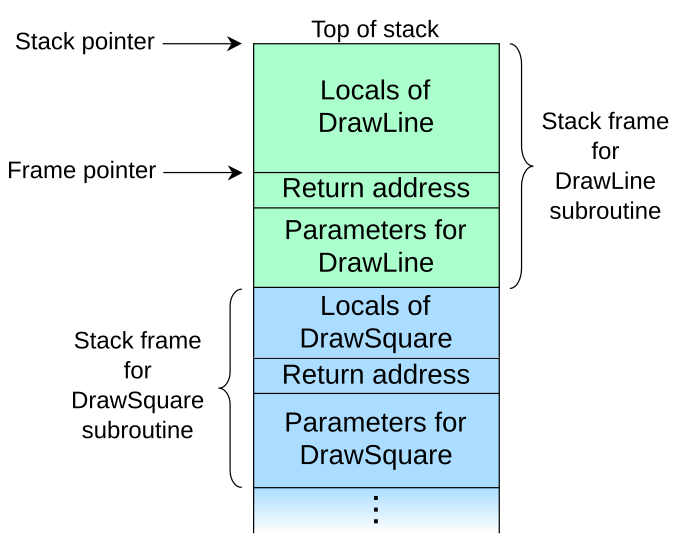

# 3. Чтение ассемблера: ISA, вызовы и стек

<figure class="epigraph">
  <blockquote>
    <p>Архитектура набора команд - это интерфейс между программным и аппаратным обеспечением. Хороший интерфейс переживает много реализаций.</p>
  </blockquote>
  <figcaption>
    Дэвид Паттерсон и Джон Хеннесси, по мотивам "Computer Organization and Design"
  </figcaption>
</figure>

В предыдущем модуле мы разобрались, как процессор хранит числа. Теперь - на каком языке с ним разговаривать. Программа на C для процессора ничего не значит: он понимает только **машинный код** - последовательность инструкций, закодированных битами. Набор этих инструкций, регистров и правил называется **архитектурой набора команд** (Instruction Set Architecture, ISA).

Мы будем работать с двумя ISA. **x86-64** стоит почти во всех ноутбуках и серверах, на нем мы будем мерить производительность. **RISC-V** - открытая и простая архитектура, на ней удобно учиться писать ассемблер руками, и она все чаще встречается в реальных устройствах, в том числе в отечественных процессорах. Писать на ассемблере в жизни приходится редко. А вот **читать** ассемблер, который сгенерировал компилятор, - ежедневный навык инженера по производительности. Ради него и этот модуль.

## ISA как контракт

Программисты любят абстракции. Когда вы открываете страницу в браузере, происходят сотни вещей: нажатия клавиш, сетевые запросы, DNS, TCP, разбор HTML, отрисовка на видеокарте. Каждый слой знает только **интерфейс** соседнего слоя и не знает, как тот устроен внутри. Это дает двойную выгоду: тем, кто пользуется модулем, достаточно знать маленький интерфейс, а тем, кто его делает, можно как угодно менять реализацию, пока соблюдается контракт.

Абстракция процессора - это ISA. Она отвечает на пять вопросов: какие есть **инструкции** и что каждая делает, как они **кодируются** в биты, сколько есть **регистров** и для чего, как устроена **память** (адреса, выравнивание, порядок байтов, правила для нескольких ядер) и как работают **исключения и прерывания** (модуль 6).

Чего ISA **не** определяет - как все это реализовано: сколько стадий у конвейера, сколько инструкций выполняется за такт, какого размера кэши. Это **микроархитектура**. Одна ISA - много микроархитектур:

<figure class="figure" markdown="1">
{ width="520" }
{ width="520" }
<figcaption>Одна ISA - много микроархитектур: контракт фиксирует инструкции, регистры и правила памяти; реализация определяет, сколько стоит их выполнение.</figcaption>
</figure>

Программа, собранная для x86-64 в 2005 году, работает на процессоре 2025 года - контракт соблюден. Но **скорость** этой программы определяется микроархитектурой. Поэтому курс постоянно ходит между двумя уровнями: ISA объясняет, **что** делает код, микроархитектура - **сколько** это стоит.

## От машины Тюринга до фон Неймана

Прежде чем сравнивать RISC и CISC, полезно вспомнить, откуда вообще взялись архитектуры и что именно делает процессор. В упрощенной картине современные компьютеры выросли из двух идей: абстрактной машины Тюринга и фон-неймановской схемы с хранимой программой. Это концептуальная история, а не точная хронология: реальные машины сочетали разные решения, а деление на гарвардскую и фон-неймановскую схемы удобно как модель.

### Машина Тюринга

В 1936 году Алан Тьюринг описал абстрактную машину для определения того, что вообще вычислимо. У нее есть бесконечная **лента**, разбитая на ячейки, **головка**, которая читает и пишет один символ, и конечный набор **состояний**. За один шаг машина смотрит на текущий символ и состояние, записывает новый символ, сдвигает головку влево или вправо и переходит в новое состояние.

<figure class="figure" markdown="1">
{ width="640" }
{ width="640" }
<figcaption>Машина Тюринга: лента с символами, головка и состояние. Правило $(q_3, 1) \to (q_4, 0, R)$ означает: в состоянии $q_3$, прочитав 1, записать 0, перейти в $q_4$ и сдвинуться вправо.</figcaption>
</figure>

Машина Тюринга не является физическим компьютером. Это модель вычислений: она показывает, что для вычисления достаточно конечного набора правил и неограниченной памяти. **Универсальная** машина Тюринга может прочитать описание другой машины и выполнить его - отсюда идея программы, которая лежит в памяти как данные.

### Гарвардская архитектура

В **гарвардской архитектуре** память команд и память данных разделены, и к ним ведут отдельные шины. Процессор может одновременно выбирать следующую инструкцию и читать или писать данные. Это снимает структурный конфликт между выборкой команды и обращением к данным.

<figure class="figure" markdown="1">
{ width="760" }
{ width="760" }
<figcaption>Слева гарвардская архитектура: отдельные памяти и шины для команд и данных. Справа фон-неймановская: одна память для программы и данных, одна шина.</figcaption>
</figure>

Гарвардская схема удобна в микроконтроллерах и цифровых сигнальных процессорах: программа обычно не меняется, а данных много. В больших процессорах ее используют частично: кэш L1 разделен на L1I для инструкций и L1D для данных, но L2, L3 и основная память общие. Такую схему называют **модифицированной гарвардской**.

### Фон-неймановская архитектура

В 1945 году в отчете о машине EDVAC Джон фон Нейман описал другой принцип: **программа хранится в той же памяти, что и данные**. Процессор читает инструкцию из памяти, декодирует ее, выполняет и переходит к следующей. Одна и та же память может содержать и код, и массивы, и стек.

<figure class="figure" markdown="1">
{ width="760" }
{ width="760" }
<figcaption>Цикл фон-неймановского процессора: PC указывает на инструкцию, память отдает ее в IR, дешифратор управляет АЛУ и регистрами, результат записывается обратно.</figcaption>
</figure>

У фон-неймановской схемы есть обратная сторона - **узкое место фон Неймана**: команды и данные идут по одной шине, поэтому процессор не может одновременно выбрать инструкцию и прочитать операнд. Кэши L1I и L1D смягчают это, но полностью не убирают.

### Как работает процессор

В схеме ниже `IR` - это **instruction register**, регистр инструкции. В него попадают биты выбранной из памяти команды, пока дешифратор разбирает, что это за операция и какие у нее операнды. Это не *intermediate representation* компилятора, которую тоже сокращают как IR: там речь идет о внутреннем представлении программы в компиляторе, а здесь - о регистре процессора.

В простейшем виде цикл выглядит так:

1. **Выборка.** `PC` содержит адрес следующей инструкции; процессор читает ее из памяти в регистр инструкции `IR`.
2. **Декодирование.** Дешифратор определяет, что это за инструкция, какие регистры и операнды нужны и что делать с результатом.
3. **Выполнение.** АЛУ считает, регистры читаются и пишутся, память загружает или сохраняет данные.
4. **Запись результата.** Результат попадает в регистр или память, `PC` увеличивается на длину инструкции или получает адрес перехода.

Такт задает ритм: за один такт конвейер продвигает несколько инструкций, но каждая отдельная инструкция проходит стадии последовательно (модуль 6). ISA описывает, **какие** инструкции существуют и что они делают; микроархитектура решает, **как быстро** они выполняются.

## Как выглядит ассемблер

Процессор исполняет **машинный код** - поток битов. В каждой инструкции закодированы операция (**opcode**), операнды и место результата. Человеческая запись того же самого называется **ассемблером**: вместо битов - мнемоники, вместо номеров регистров - имена.

### Одна операция на двух ISA

Пусть есть C-код:

```c
int c = *a + *b;
```

На x86-64 компилятор может получить три инструкции:

```asm
# *a = rsi, *b = rdi, *c = rdx
mov eax, DWORD PTR [rsi]      ; загрузить *a
add eax, DWORD PTR [rdi]      ; прибавить *b прямо из памяти
mov DWORD PTR [rdx], eax      ; записать результат
```

На RISC-V - четыре:

```asm
# a0 = a, a1 = b, a2 = c
lw  t0, 0(a0)                 ; загрузить *a
lw  t1, 0(a1)                 ; загрузить *b
add t0, t0, t1                ; сложить
sw  t0, 0(a2)                 ; записать результат
```

Разница в числе инструкций не означает разницу в скорости: x86 внутри разбивает `add` с памятью на несколько микроопераций, а RISC-V выполняет четыре простые команды. Это и есть главное отличие CISC от RISC, о котором ниже.

### Регистры и операнды

В x86-64 16 регистров общего назначения: `rax`, `rbx`, `rcx`, `rdx`, `rsi`, `rdi`, `rbp`, `rsp` и `r8`-`r15`. Их младшие части имеют свои имена: `rax` -> `eax` (32 бита) -> `ax` (16) -> `al` (8). Это не отдельные регистры, а окна в один и тот же регистр; запись в `eax` обнуляет старшие 32 бита `rax`.

В RISC-V регистров 32, и они называются `x0`-`x31`; ABI-имена (`a0`, `t0`, `s0`, `ra`, `sp`) описывают их назначение. Подробности - ниже.

Операнды бывают трех видов: регистр, непосредственное значение (константа, `immediate`) и ячейка памяти. Не все инструкции поддерживают все три вида; например, в RISC-V арифметика работает только с регистрами, а память читают и пишут отдельные `load` и `store`.

### Пересылка и адресация

`mov` не перемещает значение, а копирует его. В x86-64 у `mov` десятки форм: регистр-регистр, регистр-память, память-регистр, непосредственное значение. `xchg` меняет два регистра местами; на современных ядрах он может не добавлять тактов за счет переименования регистров, но это зависит от микроархитектуры.

Адрес в x86-64 записывается так:

```text
SIZE PTR [base + index * scale + displacement]
```

`scale` может быть 2, 4 или 8, а `SIZE` - `BYTE`, `WORD`, `DWORD` или `QWORD` (8, 16, 32 или 64 бита). Например:

```asm
mov rax, QWORD PTR [rdi + rsi*8 + 24]
lea rdx, [rdi + rsi*8 + 24]
```

Первая инструкция читает память по адресу, вторая только вычисляет адрес. `lea` часто используют как арифметику: она умеет `base + index*scale + displacement` обычно за один такт и без обращения к памяти.

### Синтаксис AT&T и Intel

У x86-64 два распространенных синтаксиса. В Intel (его использует документация Intel и Godbolt с `-masm=intel`) порядок операндов *приемник, источник*:

```asm
mov rax, 1
add rax, rsi
```

В AT&T (по умолчанию у GCC в Linux) порядок *источник, приемник*, регистры пишутся с `%`, константы с `$`, а к имени инструкции добавляется суффикс размера:

```asm
movq $1, %rax
addq %rsi, %rax
```

Суффиксы AT&T: `b` - байт, `w` - слово (16 бит), `l` - 32 бита, `q` - 64 бита. В Intel размер задается перед операндом: `DWORD PTR`, `QWORD PTR`.

Разобранный машинный код можно посмотреть через `objdump -d`; ассемблер из компилятора - через `gcc -S`. Краткая шпаргалка по командам x86-64 и RISC-V есть в [приложении](../appendix/asm.md).

## RISC и CISC

Исторически ISA развивались по двум философиям.

**CISC** (Complex Instruction Set Computer) - много сложных инструкций. В 1970-е память была дорогой и медленной, компиляторы - слабыми, а программы часто писали на ассемблере вручную. Выгодно было, чтобы одна инструкция делала как можно больше: загрузила операнд из памяти, сложила и записала результат обратно. Типичный представитель - x86, который ведет родословную от Intel 8086 (1978), через 32-битный 80386 (1985) до 64-битного расширения AMD64 (2003). Все это время сохранялась обратная совместимость - и весь накопленный багаж.

**RISC** (Reduced Instruction Set Computer) появился в начале 1980-х: проект RISC I Дэвида Паттерсона в Беркли и MIPS Джона Хеннесси в Стэнфорде. Идея: оставить простые инструкции фиксированной длины, которые выполняются за один такт и легко идут в конвейер, а сложную работу переложить на компилятор. Отсюда ARM, MIPS, SPARC, PowerPC - и **RISC-V**, который те же люди из Беркли начали в 2010 году как открытую ISA без лицензионных отчислений.

| | RISC-V | x86-64 |
|---|---|---|
| длина инструкции | 32 бита (16 со сжатым расширением C) | от 1 до 15 байт |
| операнды в памяти | только инструкции `load` и `store` | почти любая инструкция может читать память |
| регистры общего назначения | 32 (`x0` всегда равен нулю) | 16 |
| флаги | нет: сравнение встроено в инструкцию перехода | регистр RFLAGS; его пишут арифметические и логические инструкции |
| сложные режимы адресации | только `база + смещение` | `база + индекс * масштаб + смещение` |
| внутри процессора | почти 1:1 в микрооперации | декодируется в RISC-подобные микрооперации |

Сейчас граница размыта. Современный x86 внутри разбивает сложные инструкции на простые микрооперации и выполняет их на RISC-подобном ядре. А в RISC-ISA добавляют все больше специализированных инструкций (векторы, криптография, битовые операции). Но декодер x86 с инструкциями переменной длины по-прежнему сложнее, больше и дороже по энергии - поэтому в телефонах и все чаще в серверах (AWS Graviton, Apple M) стоят RISC-процессоры.

Разницу хорошо видно на одной строке C:

```c
long f(long *a, long i) { return a[i + 3]; }
```

Соберите с `gcc -O2` для x86-64 и с `riscv64-linux-gnu-gcc -O2 -march=rv64gc` для RISC-V:

```asm
# x86-64: одна инструкция, адрес считается внутри нее
f:  mov   rax, QWORD PTR 24[rdi+rsi*8]
    ret

# RISC-V: адрес считаем отдельными инструкциями
f:  slli  a1, a1, 3          # i * 8
    add   a0, a0, a1         # a + i * 8
    ld    a0, 24(a0)         # загрузка по адресу + 24
    ret
```

Больше инструкций - не значит медленнее: три простые инструкции RISC-V легко выполняются за пару тактов, а сложная инструкция x86 внутри тоже разбирается на части. Число инструкций и время работы - разные вещи (вспомните $T = N_{instr} \cdot CPI / f$ из модуля 1).

## Модульность RISC-V

RISC-V устроен как конструктор. Есть маленькая обязательная **база** и набор **расширений**, обозначаемых буквами:

| Обозначение | Что добавляет |
|---|---|
| RV32I / RV64I | база: около 40 целочисленных инструкций, 32 или 64 бита |
| M | умножение и деление |
| A | атомарные операции (для многопоточности, модуль 18) |
| F / D | числа с плавающей точкой одинарной / двойной точности (модуль 4) |
| C | сжатые 16-битные версии частых инструкций - код короче на 25-30% |
| V | векторные инструкции (модуль 16) |
| Zba, Zbb, Zbs | битовые операции: `sh1add`, `cpop`, `clz`, `rev8` и др. (модуль 2) |
| Zicond | условное обнуление - замена условной пересылки (модуль 7) |

Сокращение `G` означает `IMAFD` плюс пара служебных расширений, поэтому типичная цель для Linux - `rv64gc`. Чтобы разработчики ОС и приложений не путались в комбинациях, расширения собирают в **профили**: RVA22, RVA23. Профиль RVA23 включает векторы и битовые расширения. При этом дистрибутив может по умолчанию целиться в базовый `rv64gc`, поэтому `-march` указываем всегда и проверяем, что именно делает компилятор: `riscv64-linux-gnu-gcc -Q --help=target`.

### Регистры RISC-V

32 целочисленных регистра `x0`-`x31` по 64 бита (в RV64). У каждого, кроме номера, есть **ABI-имя**, которое говорит, как его принято использовать (подробно - ниже):

| Регистр | ABI-имя | Назначение |
|---|---|---|
| `x0` | `zero` | всегда 0 |
| `x1` | `ra` | адрес возврата |
| `x2` | `sp` | указатель стека |
| `x3` | `gp` | глобальные данные |
| `x4` | `tp` | данные потока |
| `x5-x7` | `t0-t2` | временные |
| `x8-x9` | `s0-s1` | сохраняемые (`s0` = `fp`) |
| `x10-x17` | `a0-a7` | аргументы и результат |
| `x18-x27` | `s2-s11` | сохраняемые |
| `x28-x31` | `t3-t6` | временные |

Регистр `x0` всегда читается как ноль, а запись в него игнорируется. Это не мелочь, а элегантный трюк: многие "отдельные" инструкции на самом деле - частные случаи общих. Например, `mv a0, a1` - это `addi a0, a1, 0`, а `nop` - это `addi x0, x0, 0`.

## Как кодируются инструкции

Все базовые инструкции RISC-V - 32 бита. Есть шесть **форматов**, которые различаются тем, как разложены поля:

<figure class="figure" markdown="1">
{ width="860" }
{ width="860" }
<figcaption>Шесть форматов команд RISC-V. Ширина полей пропорциональна числу бит; поля <code>rs1</code>, <code>rs2</code> и <code>rd</code> стоят на одних и тех же местах, поэтому декодер читает регистры, еще не зная тип команды.</figcaption>
</figure>

(В старых источниках B и J называются SB и UJ.)

- `opcode` (7 бит) - класс инструкции; `funct3` и `funct7` уточняют операцию.
- `rd` - регистр результата, `rs1` и `rs2` - регистры-источники. По 5 бит - как раз на 32 регистра.
- `imm` - непосредственное значение (константа), знаково расширяется до 64 бит.

Обратите внимание на главную идею дизайна: поля `rs1`, `rs2`, `rd` **всегда на одних и тех же местах** во всех форматах, где они есть. Декодер может начать читать регистры, еще не зная, какая это инструкция. А странная перетасовка бит константы в форматах B и J сделана для того же: чтобы бит знака всегда был в позиции 31, а остальные биты константы совпадали между форматами.

### Пример: `add x5, x6, x7`

Формат R, `opcode = 0110011`, `funct3 = 000`, `funct7 = 0000000`, `rd = 5`, `rs1 = 6`, `rs2 = 7`:

<figure class="figure" markdown="1">
{ width="720" }
{ width="720" }
<figcaption>Кодирование <code>add x5, x6, x7</code> и <code>addi a0, a0, -1</code>: поля, двоичные значения и 32-битное слово в шестнадцатеричном виде.</figcaption>
</figure>

Проверка ассемблером:

```bash
echo 'add x5, x6, x7' > e.s
riscv64-linux-gnu-as -march=rv64g e.s -o e.o
riscv64-linux-gnu-objdump -d e.o
#    0:   007302b3    add  t0,t1,t2
```

`objdump` печатает ABI-имена: `x5` - это `t0`, `x6` - `t1`, `x7` - `t2`.

### Отрицательная константа

`addi a0, a0, -1` - формат I. Константа $-1$ в 12 битах дополнительного кода - `111111111111` (вспомните модуль 2); второй пример на рисунке выше показывает ее поля и слово `0xFFF50513`.

12 бит константы - это диапазон от $-2048$ до $2047$. А как загрузить в регистр число побольше, например `0x12345678`? Двумя инструкциями: `lui` кладет старшие 20 бит, `addi` добавляет младшие 12. Ассемблер делает это сам, если написать псевдоинструкцию `li a0, 0x12345678`.

### Сжатые инструкции

Если собрать тот же `addi a0, a0, -1` с `-march=rv64gc`, `objdump` покажет 16-битную инструкцию `157d` (`c.addi`). Ассемблер автоматически заменяет частые инструкции сжатыми версиями из расширения C. Процессор разворачивает их обратно в обычные при декодировании - это просто способ сэкономить место в кэше инструкций.

### Псевдоинструкции

Многие привычные "инструкции" RISC-V на самом деле - сокращения, которые ассемблер разворачивает в настоящие:

| Пишем | На самом деле |
|---|---|
| `mv rd, rs` | `addi rd, rs, 0` |
| `li rd, imm` | `addi rd, x0, imm` или `lui` + `addi` |
| `not rd, rs` | `xori rd, rs, -1` |
| `neg rd, rs` | `sub rd, x0, rs` |
| `j label` | `jal x0, label` |
| `ret` | `jalr x0, 0(ra)` |
| `nop` | `addi x0, x0, 0` |
| `beqz rs, label` | `beq rs, x0, label` |
| `call f` | `auipc ra, ...` + `jalr ra, ...(ra)` |

`objdump -M no-aliases` показывает настоящие инструкции вместо псевдо.

> **Проверьте себя.** Почему в RISC-V нет отдельной инструкции `sub` с константой (`subi`)? (Подсказка: чем `subi a0, a0, 5` отличается от `addi a0, a0, -5`?)

## Читаем вывод компилятора

Главный навык этого модуля. Возьмем функцию:

```c
long sum(const long *a, long n) {
    long s = 0;
    for (long i = 0; i < n; i++) s += a[i];
    return s;
}
```

Получить ассемблер можно тремя способами:

```bash
gcc -O1 -S sum.c -o -                  # ассемблер из компилятора
gcc -O1 -c sum.c && objdump -d sum.o   # дизассемблировать объектный файл
```

Или [Compiler Explorer](https://godbolt.org): код слева, ассемблер справа, строки подсвечиваются цветом. Это самый удобный способ для экспериментов.

RISC-V (`riscv64-linux-gnu-gcc -O1 -march=rv64gc`, GCC 15, комментарии наши):

```asm
sum:    ble   a1, zero, .L4      # n <= 0 -> вернуть 0
        mv    a5, a0             # p = a
        slli  a1, a1, 3          # n * 8
        add   a3, a0, a1         # end = a + n
        li    a0, 0              # s = 0
.L3:    ld    a4, 0(a5)          # загрузить *p
        add   a0, a0, a4         # s += *p
        addi  a5, a5, 8          # p++
        bne   a5, a3, .L3        # пока p != end
        ret
.L4:    li    a0, 0
        ret
```

x86-64 (`gcc -O1 -masm=intel`, GCC 15):

```asm
sum:    test  rsi, rsi
        jle   .L4
        mov   rax, rdi
        lea   rcx, [rdi+rsi*8]       ; end = a + n
        mov   edx, 0
.L3:    add   rdx, QWORD PTR [rax]   ; загрузка и сложение в одной инструкции
        add   rax, 8
        cmp   rax, rcx
        jne   .L3
.L1:    mov   rax, rdx
        ret
.L4:    mov   edx, 0
        jmp   .L1
```

Что стоит заметить:

1. **Компилятор переписал цикл.** Вместо индекса `i` и вычисления `a + i * 8` на каждой итерации - указатель, который сдвигается на 8, и сравнение с концом массива. Это классическая оптимизация (strength reduction).
2. **Проверка `n <= 0` вынесена до цикла**, а условие продолжения стоит в конце тела. Так на каждой итерации один переход, а не два (подробнее - ниже).
3. **x86 читает операнд прямо из памяти** в `add rdx, [rax]`, RISC-V делает это двумя инструкциями: `ld` и `add`.
4. **x86 сравнивает через флаги**: `cmp` пишет RFLAGS, `jne` их читает. В RISC-V сравнение и переход - одна инструкция `bne`.
5. В цикле по 4 инструкции на обеих ISA.

### Две записи ассемблера x86

Для x86 существуют два синтаксиса, и в интернете вы встретите оба:

| | Intel | AT&T (по умолчанию в GCC) |
|---|---|---|
| порядок операндов | `add rdx, rax` (куда, откуда) | `addq %rax, %rdx` (откуда, куда) |
| регистры | `rax` | `%rax` |
| константы | `5` | `$5` |
| память | `QWORD PTR [rdi+rsi*8+24]` | `24(%rdi,%rsi,8)` |

Флаг `-masm=intel` переключает GCC на синтаксис Intel, в Godbolt он включен по умолчанию. Мы будем использовать Intel - он ближе к документации процессоров.

## Вызов функции и возврат

Вызов функции - это переход, после которого нужно уметь вернуться. Значит, где-то нужно запомнить **адрес возврата** - адрес инструкции после вызова.

| | RISC-V | x86-64 |
|---|---|---|
| вызов | `jal ra, f` - адрес возврата в регистр `ra` | `call f` - адрес возврата кладется в стек |
| возврат | `ret` = `jalr x0, 0(ra)` - переход по адресу из `ra` | `ret` - снимает адрес со стека и переходит |
| вызов по указателю | `jalr ra, 0(t0)` | `call rax` или `call [mem]` |

В RISC-V адрес возврата хранится в **регистре**. Это быстро, но значит: если функция сама кого-то вызывает, она перезапишет `ra`, и нужно сохранить старое значение - обычно в стек. Функция, которая никого не вызывает, называется **листовой** (leaf function), и ей сохранять `ra` не нужно.

В x86 адрес возврата всегда кладется в стек инструкцией `call`. Это проще для программиста, но каждое обращение - это запись и чтение памяти.

## Соглашение о вызовах

Представьте, что функция `f` вызывает функцию `g`. Обе хотят пользоваться регистрами. Если `g` испортит регистр, в котором `f` хранила что-то важное, `f` после возврата получит мусор. Есть два способа договориться:

- **caller-saved** (сохраняет вызывающий): `g` может портить регистр как угодно, а если `f` нужно его значение после вызова, она сама сохранит его до вызова;
- **callee-saved** (сохраняет вызываемый): `g` обязана вернуть регистр в том же состоянии, в каком получила, а если хочет им пользоваться - сохраняет и восстанавливает сама.

Соглашение о вызовах делит все регистры на эти две группы и определяет, где передаются аргументы:

| | RISC-V LP64D | x86-64 System V (Linux) |
|---|---|---|
| целые аргументы | `a0`-`a7` | `rdi`, `rsi`, `rdx`, `rcx`, `r8`, `r9` |
| аргументы с плавающей точкой | `fa0`-`fa7` | `xmm0`-`xmm7` |
| результат | `a0` (и `a1` для 128 бит) | `rax` (и `rdx`) |
| callee-saved | `s0`-`s11`, `sp` | `rbx`, `rbp`, `r12`-`r15`, `rsp` |
| caller-saved | `t0`-`t6`, `a0`-`a7`, `ra` | `rax`, `rcx`, `rdx`, `rsi`, `rdi`, `r8`-`r11` |
| выравнивание стека | 16 байт всегда | 16 байт в момент `call` |

Если аргументов больше, чем регистров, остальные передаются через стек. Windows на x86-64 использует **другое** соглашение (аргументы в `rcx`, `rdx`, `r8`, `r9`) - еще одна причина, почему ассемблер не переносится между ОС.

Практическое правило для ассемблера:

1. Хотите, чтобы значение пережило вызов другой функции - храните его в `s`-регистре (RISC-V) или в `rbx`, `r12`-`r15` (x86).
2. Используете `s`-регистр - сохраните его в прологе и восстановите в эпилоге.
3. После **любого** вызова считайте все `t`- и `a`-регистры испорченными, даже если "вы знаете", что вызываемая функция их не трогает. Завтра ее перепишут.

> **Проверьте себя.** Зачем вообще нужны две группы регистров? Почему бы не объявить все регистры callee-saved - тогда вызывающему ничего не нужно было бы сохранять?

## Стек и стековый кадр

**Стек** - область памяти, которая растет вниз (к меньшим адресам). Регистр `sp` указывает на его вершину. Каждая функция, которой нужна память для сохраненных регистров и локальных переменных, отрезает себе кусок стека - **стековый кадр** - в начале работы и отдает его в конце.

<figure class="figure" markdown="1">
{ width="560" }
<figcaption>Стековый кадр: локальные переменные, адрес возврата и параметры. Источник: R. S. Shaw, Wikimedia Commons, public domain.</figcaption>
</figure>

Код, который создает кадр, называется **прологом**, код, который его убирает, - **эпилогом**. Вот функция, которой нужен кадр: она вызывает другую функцию и хранит `x` и `y` через вызов.

```c
extern long g(long);

long frame(long x, long y) {
    long a = x + 1;
    long b = y * 2;
    return g(a * b) + x + y;
}
```

Соберите с `riscv64-linux-gnu-gcc -O1 -march=rv64gc`:

```asm
frame:  addi  sp, sp, -32        # пролог: отрезать 32 байта (кратно 16)
        sd    ra, 24(sp)         # сохранить адрес возврата
        sd    s0, 16(sp)         # и callee-saved регистры, которые будем портить
        sd    s1, 8(sp)
        mv    s1, a0             # сохранить x
        mv    s0, a1             # сохранить y
        addi  a0, a0, 1          # a = x + 1
        mul   a0, a0, a1         # a * b
        slli  a0, a0, 1          # b = y * 2 уже учтено
        call  g
        add   a0, a0, s1         # + x
        add   a0, a0, s0         # + y
        ld    s1, 8(sp)          # эпилог: восстановить в обратном порядке
        ld    s0, 16(sp)
        ld    ra, 24(sp)
        addi  sp, sp, 32         # вернуть стек
        ret
```

Почему выравнивание по 16 байт? Некоторые инструкции (векторные, 128-битные загрузки) требуют выровненных адресов, и соглашение гарантирует, что на входе в любую функцию `sp` кратен 16. Если вы сдвинули `sp` на 8, гарантия нарушена для всех функций, которые вы вызовете. В x86 это видно даже в тривиальной функции: перед `call` компилятор пишет `sub rsp, 8` - потому что сама инструкция `call`, которой вызвали текущую функцию, положила в стек 8 байт адреса возврата, и стек "сбился" на 8.

### Рекурсия: факториал

Рекурсивная функция - не особый случай, а обычная нелистовая функция: перед вызовом самой себя она должна сохранить `ra` и все, что понадобится после вызова.

```c
long fact(long n) {
    return n <= 1 ? 1 : n * fact(n - 1);
}
```

Соберите с `riscv64-linux-gnu-gcc -O0 -march=rv64gc`; ниже - схема кадра, точный вывод зависит от версии GCC.

```asm
    .text
    .globl  fact
    .type   fact, @function
fact:                           # a0 = n
    li      t0, 1
    bgt     a0, t0, 1f          # n > 1 -> рекурсия
    li      a0, 1               # fact(0) = fact(1) = 1
    ret                         # листовой путь: стек не нужен
1:  addi    sp, sp, -16         # пролог: место под ra и s0
    sd      ra, 8(sp)
    sd      s0, 0(sp)
    mv      s0, a0              # сохранить n: после вызова a0 будет испорчен
    addi    a0, a0, -1
    call    fact                # a0 = fact(n - 1)
    mul     a0, a0, s0          # n * fact(n - 1)
    ld      s0, 0(sp)           # эпилог
    ld      ra, 8(sp)
    addi    sp, sp, 16
    ret
    .size   fact, .-fact
```

Почему `n` хранится в `s0`, а не в `t0`? Потому что `t0` - caller-saved, и рекурсивный вызов имеет полное право его испортить (и испортит: первая же строка `fact` пишет в `t0`). А `s0` любой вызов `fact` вернет нетронутым - но для этого каждый вызов сохраняет и восстанавливает его. Получается цепочка кадров, по одному на уровень рекурсии:

<figure class="figure" markdown="1">
{ width="560" }
{ width="560" }
<figcaption>Кадры рекурсивного <code>fact</code>: каждый вызов добавляет 16-32 байта стека, а <code>fact(1)</code> возвращается по листовому пути без кадра.</figcaption>
</figure>

Каждый уровень рекурсии стоит 16-32 байта стека и несколько инструкций на пролог и эпилог. Стек обычно ограничен 8 МБ (`ulimit -s`), поэтому глубокая рекурсия (миллионы уровней) падает с Segmentation fault.

## Стек и куча

До сих пор память в примерах была либо в регистрах, либо в стеке. Стек - это автоматическая память: компилятор двигает `sp` в прологе и эпилоге, а переменные живут ровно столько, сколько выполняется функция. Выделение на стеке стоит одну инструкцию `addi sp, sp, -N`, освобождение - обратную. Плата - ограниченный размер (обычно 8 МБ, `ulimit -s`), порядок LIFO и невозможность вернуть память из функции наружу.

Куча - это память, которой управляет аллокатор: `malloc`, `calloc`, `realloc`, `free`. Под `malloc` лежит код, который ищет свободный блок в своих структурах, иногда просит у ядра новую страницу (`brk`/`mmap`) и ведет метаданные. Поэтому `malloc` дороже, чем `addi sp`, а `free` должен вернуть блок в нужный список. Куча не исчезает при возврате из функции: если забыть `free`, получится утечка; если освободить дважды - неопределенное поведение.

```c
void f(int n) {
    int a[100];                        // стек: умрет при выходе
    int *p = malloc(n * sizeof *p);    // куча: живет до free
    ...
    free(p);
}
```

Стек хорош для маленьких данных с короткой жизнью, куча - для данных, которые переживают функцию или размер которых неизвестен заранее. У кучи есть фрагментация и накладные расходы на метаданные; у стека - риск переполнения при глубокой рекурсии или большом массиве.

В модуле 12 мы соберем динамический массив и хеш-таблицу, которые выделяют память на куче, а в модуле 13 посмотрим, как раскладка данных влияет на кэш. Понимание стека и кучи понадобится, чтобы написать свой арена- или pool-аллокатор: он выделяет большой блок и раздает из него куски, экономя на `malloc` и улучшая локальность.

## Цена вызова и что с ней делает компилятор

Вызов функции - это переход туда, переход обратно, пролог, эпилог, перекладывание аргументов. Для функции из трех инструкций накладные расходы больше полезной работы. Поэтому компилятор:

- **встраивает** (inline) маленькие функции: копирует тело на место вызова. Пролога, эпилога и переходов нет совсем, а компилятор может дальше оптимизировать встроенный код вместе с окружающим;
- **превращает хвостовую рекурсию в цикл**: если рекурсивный вызов - последнее действие функции, кадр можно не создавать заново;
- иногда превращает в цикл и не-хвостовую рекурсию.

Вот что GCC 15 с `-O2 -march=rv64gc` делает с рекурсивным факториалом на C:

```asm
fact:   mv    a5, a0
        li    a0, 1
        mv    a3, a0
        ble   a5, a0, .L1
.L2:    mul   a0, a0, a5        # рекурсии нет: обычный цикл
        addi  a5, a5, -1
        bne   a5, a3, .L2
.L1:    ret
```

Ни стека, ни вызовов: компилятор понял, что умножение ассоциативно, и переписал рекурсию в цикл с накопителем. А с `-O0` та же функция компилируется почти буквально, с кадром, сохранением `n` в стек и честным `call fact`.

### Косвенные вызовы

Вызов по указателю на функцию (а в C++ - вызов виртуального метода) дороже прямого по двум причинам:

1. **Его нельзя встроить**: компилятор не знает, какая функция будет вызвана.
2. **Процессору нужно угадать адрес**. Для прямого вызова адрес записан в инструкции, для косвенного - в регистре, который еще может быть не вычислен. Процессор предсказывает его по истории (модуль 7), и если ошибается, теряет 15-20 тактов.

Поэтому в горячих циклах указатели на функции - подозрительное место. В [задании 3](../tasks/03-assembly.md) функция `apply` вызывает `f` по указателю на каждой итерации - как раз такой случай.

## Итоги

- ISA - контракт между программой и процессором: инструкции, их кодирование, регистры, модель памяти. Микроархитектура - реализация этого контракта, от нее зависит скорость.
- RISC - простые инструкции фиксированной длины, работа с памятью только через `load`/`store`. CISC - сложные инструкции переменной длины. Современный x86 внутри тоже RISC-подобный.
- RISC-V модульный: база плюс расширения. Всегда указывайте `-march`.
- Читать ассемблер - главный навык. Компилятор переписывает циклы, выносит проверки, по-разному использует возможности ISA.
- На уровне ISA есть только переходы. `if`, циклы и `switch` - это переходы на инвертированное условие, перевернутые циклы и таблицы адресов.
- Вызов функции - это переход с сохранением адреса возврата: в RISC-V - в регистре `ra`, в x86 - в стеке.
- ABI делит регистры на caller-saved и callee-saved и задает, где аргументы и результат. Нарушение ABI ломает программу не в вашей функции, а позже и в другом месте.
- Стековый кадр хранит адрес возврата, сохраненные регистры и локальные данные. `sp` всегда кратен 16.
- Вызов функции стоит несколько тактов. Компилятор встраивает функции и превращает рекурсию в циклы, а косвенные вызовы мешают ему это делать.
- Ассемблер читают, чтобы понять стоимость кода, а не чтобы писать на нем функции.
- Стек выделяется одним движением `sp`; куча - через `malloc`/`free` с метаданными, фрагментацией и утечками.

## Что почитать

- System V AMD64 ABI, раздел 3.2 "Function Calling Sequence"; RISC-V ELF psABI.
- R. Bryant, D. O'Hallaron, Computer Systems: A Programmer's Perspective, гл. 3.7 "Procedures".

---

Задание к модулю: [Чтение ассемблера](../tasks/03-assembly.md).
