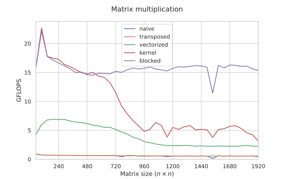

# 11. Cache-friendly алгоритмы и раскладка данных

!!! warning "WIP"
    Материал в работе: текст и задания могут меняться.

Знаем, сколько стоит память. Теперь проектируем алгоритмы и структуры данных так, чтобы каждая загруженная линия использовалась полностью и не один раз. Главный пример - умножение матриц: от порядка циклов и блочности оно ускоряется в разы еще до всякого SIMD.

## Модель внешней памяти

Две величины: $M$ - размер кэша, $B$ - размер блока. Стоимость алгоритма - число переданных блоков, а не число операций.

| Задача | Число блоков |
|---|---|
| проход по массиву | $\Theta(N / B)$ |
| случайные обращения | $\Theta(N)$ |
| сортировка | $\Theta\left(\frac{N}{B} \log_{M/B} \frac{N}{B}\right)$ |

## Порядок циклов

```c
for (i) for (j) for (k) c[i][j] += a[i][k] * b[k][j];   // ijk
for (i) for (k) for (j) c[i][j] += a[i][k] * b[k][j];   // ikj
```

```text
 ijk: b читается по столбцу              ikj: все читается по строкам

   b                                       b
 +-+-+-+-+                               +-+-+-+-+
 |x| | | |  каждый элемент -              |x|x|x|x|  одна линия -
 |x| | | |  новая кэш-линия               | | | | |  8 или 16 элементов
 |x| | | |                                | | | | |
 |x| | | |                                | | | | |
 +-+-+-+-+                               +-+-+-+-+
```

Ответ на вопрос из модуля 1: число операций то же, а промахов в $B / \text{sizeof(float)}$ раз меньше. Альтернатива - заранее транспонировать $b$.

## Блочность (tiling)

Разбиваем матрицы на блоки $b \times b$, чтобы три блока помещались в кэш:

$$
3 b^2 \cdot \text{sizeof(float)} \le C
\quad\Rightarrow\quad
b \le \sqrt{\frac{C}{12}}
$$

Для L1 32 КБ: $b \le 52$, берем кратное ширине вектора: 32 или 48. Для L2 - блоки больше. Многоуровневая блочность - основа BLAS (модуль 19).

<figure class="figure" markdown="1">

<figcaption>Производительность блочной версии умножения матриц в зависимости от размера. Источник: Algorithmica (S. Slotin), en.algorithmica.org/hpc/algorithms/matmul.</figcaption>
</figure>

```c
for (ii = 0; ii < n; ii += b)
  for (kk = 0; kk < n; kk += b)
    for (jj = 0; jj < n; jj += b)
      // умножить блоки: c[ii..][jj..] += a[ii..][kk..] * b[kk..][jj..]
```

## Cache-oblivious алгоритмы

Не знаем $M$ и $B$ - делим задачу пополам рекурсивно. На каком-то уровне рекурсии подзадача поместится в любой кэш, и алгоритм оптимален для всех уровней сразу.

Пример - транспонирование:

```c
void transpose(int n0, int n1, int m0, int m1) {   // блок [n0,n1) x [m0,m1)
    if (n1 - n0 <= 32 && m1 - m0 <= 32) { /* наивно */ return; }
    if (n1 - n0 >= m1 - m0) {
        int nm = (n0 + n1) / 2;
        transpose(n0, nm, m0, m1); transpose(nm, n1, m0, m1);
    } else {
        int mm = (m0 + m1) / 2;
        transpose(n0, n1, m0, mm); transpose(n0, n1, mm, m1);
    }
}
```

## Раскладка данных: AoS, SoA

```text
 AoS:   x y z m | x y z m | x y z m | x y z m        struct P { float x,y,z,m; } p[n];
 SoA:   x x x x ... | y y y y ... | z z z z ... | m m m m ...
                                                     struct { float x[n], y[n], z[n], m[n]; };
```

- Нужны все поля сразу - AoS.
- Обрабатываем одно поле по всем объектам - SoA: меньше лишних байт в линиях и естественная векторизация.
- Компромисс AoSoA: блоки по 8 или 16 объектов в формате SoA.

## Выравнивание и упаковка

- Поля структуры выравниваются по своему размеру: `{char; int; char;}` занимает 12 байт, а `{int; char; char;}` - 8.
- `alignas(64)` - начало на границе кэш-линии.
- Указатели против индексов: связный список - каждая вершина в своей линии, массив с индексами `uint32_t` - вдвое меньше памяти, чем 64-битные указатели.

## Итоги

- Порядок обхода памяти стоит больше, чем арифметика: модель внешней памяти объясняет, почему.
- Блочность подгоняет рабочее множество под кэш; размер блока берется из размеров кэшей.
- Cache-oblivious алгоритмы дают тот же эффект без знания размеров.
- Раскладка (AoS/SoA), выравнивание и индексы вместо указателей меняют число обращений к памяти.

## Что почитать

- Статья: M. Frigo et al., Cache-Oblivious Algorithms, 1999.

---

Задание к модулю: [Транспонирование и блочность](../tasks/11-cache-friendly.md).
