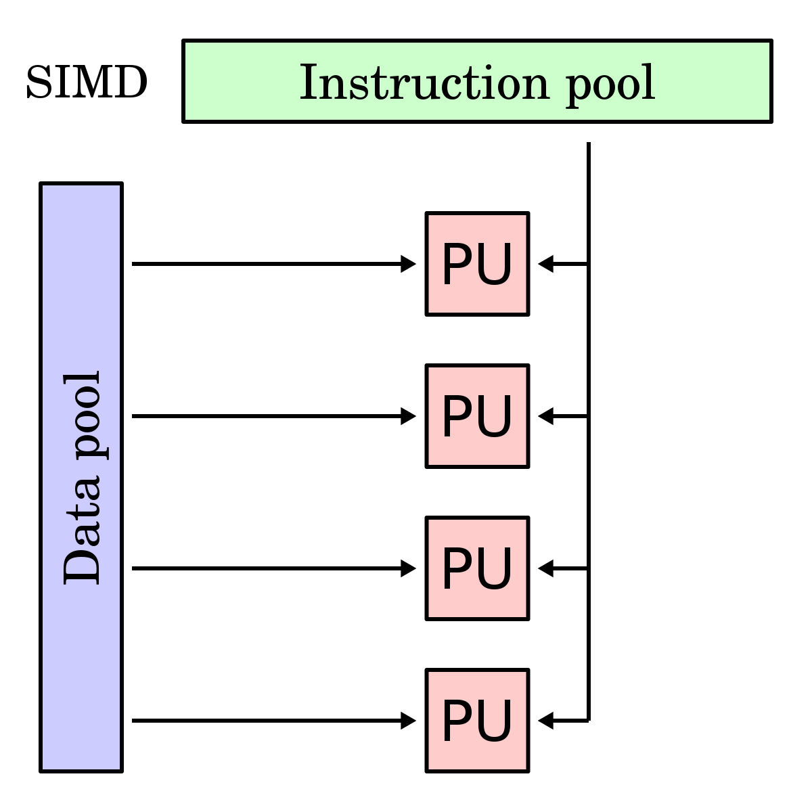
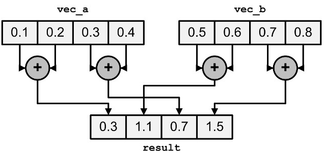

# 15. SIMD: векторные регистры и интринсики

!!! warning "WIP"
    Материал в работе: текст и задания могут меняться.

Одна инструкция - сразу 8 (AVX2) или 16 (AVX-512) операций над `float`. Это самый большой множитель производительности, доступный одному ядру. Компилятор умеет векторизовать сам, но только простые циклы. Остальное - руками, через интринсики.

## Регистры

```text
 SSE     xmm0-15    128 бит  |f|f|f|f|
 AVX/2   ymm0-15    256 бит  |f|f|f|f|f|f|f|f|
 AVX-512 zmm0-31    512 бит  |f|f|f|f|f|f|f|f|f|f|f|f|f|f|f|f|   + маски k0-k7
 NEON    v0-31      128 бит  (AArch64, фиксированная ширина)
 SVE     z0-31      128..2048 бит, ширина известна только при запуске
 RVV     v0-31      VLEN бит, ширина известна только при запуске (модуль 16)
```

`f` - 32-битный элемент (полоса, lane).

<figure class="figure" markdown="1">

<figcaption>SIMD: одна инструкция управляет несколькими одинаковыми исполнительными блоками, каждый со своей полосой данных. Источник: Algorithmica (S. Slotin), en.algorithmica.org/hpc/simd.</figcaption>
</figure>

## Интринсики

Функции C, которые компилятор превращает в одну инструкцию, но регистры распределяет сам.

| Тип | Содержимое |
|---|---|
| `__m256` | 8 x `float` |
| `__m256d` | 4 x `double` |
| `__m256i` | целые: 32 x 8, 16 x 16, 8 x 32 или 4 x 64 бит |

Имена: `_mm256_<операция>_<тип>`: `ps` - packed single, `pd` - double, `epi32` - 32-битные целые.

```c
#include <immintrin.h>
__m256 a = _mm256_loadu_ps(p);         // загрузить 8 float (без выравнивания)
__m256 b = _mm256_set1_ps(2.0f);       // 8 копий числа
__m256 c = _mm256_fmadd_ps(a, b, a);   // a*b + a
_mm256_storeu_ps(q, c);
```

Сборка: `-mavx2 -mfma` или `-march=native`. Без них - ошибка компиляции. Выбор во время выполнения: `__builtin_cpu_supports("avx2")` и `__attribute__((target("avx2")))`.

## Загрузка, выравнивание, хвост

- `load` требует адрес, кратный 32; `loadu` - любой. На современных CPU `loadu` по выровненному адресу так же быстр.
- Пересечение границы кэш-линии стоит дороже.
- Если $n$ не кратно 8, остаток (хвост) обрабатываем скалярно или маской.

## Редукция

<figure class="figure" markdown="1">
{ width="520" }
<figcaption>Горизонтальная редукция: вектор сворачивается в одно число. Источник: Algorithmica (S. Slotin).</figcaption>
</figure>

```c
float sum(const float *a, size_t n) {
    __m256 acc = _mm256_setzero_ps();
    size_t i = 0;
    for (; i + 8 <= n; i += 8)
        acc = _mm256_add_ps(acc, _mm256_loadu_ps(a + i));
    __m128 lo = _mm_add_ps(_mm256_castps256_ps128(acc),
                           _mm256_extractf128_ps(acc, 1));
    lo = _mm_hadd_ps(lo, lo);
    lo = _mm_hadd_ps(lo, lo);
    float s = _mm_cvtss_f32(lo);
    for (; i < n; i++) s += a[i];        // хвост
    return s;
}
```

Здесь снова цепочка зависимостей (модуль 6): один `acc` дает 1 вектор за $L_{add}$ тактов. Нужно несколько векторных аккумуляторов.

## Ожидаемое ускорение

$$
S \le W \quad (\text{число полос})
$$

Но только если упираемся в вычисления. Если упираемся в память - SIMD не поможет: данные не успевают приходить. Простая модель (roofline):

$$
P = \min\left( P_{peak},\; I \cdot BW \right), \qquad I = \frac{\text{FLOP}}{\text{байт}}
$$

Сумма массива: 1 FLOP на 4 байта, $I = 0.25$. При 20 ГБ/с - не больше 5 GFLOPS, сколько бы полос ни было. Поэтому SIMD-сумма в кэше и в DRAM ускоряется по-разному.

## Автовекторизация

Компилятор векторизует цикл, если: - число итераций вычислимо до входа в цикл; - нет зависимостей между итерациями (кроме редукций); - нет алиасинга (или он проверяем); - для `float`-редукций разрешена перестановка (`-ffast-math` / `-fassociative-math`).

Проверка: `-fopt-info-vec-missed` (GCC), `-Rpass-missed=loop-vectorize` (Clang).

> **Пометка на будущее.** Стоит рассмотреть [ISPC](https://github.com/ispc/ispc) - компилятор SPMD-программ для CPU. Вместо ручных интринсиков в нем пишут C-подобный код с `foreach`, а компилятор сам подбирает AVX2/AVX-512/NEON и маски. Если тема зайдет, из этого может получиться отдельный раздел или вариант задания.

## Итоги

- Одна векторная инструкция обрабатывает 4-16 чисел; регистры и набор инструкций задают ширину.
- Хвост и горизонтальная редукция - самая частая причина, почему ускорение меньше ширины вектора.
- Автовекторизация работает, когда компилятор видит независимость итераций; `-ffast-math` для `float` снимает часть запретов.
- Предел ускорения задает roofline: вычисления или память.

## Что почитать

- [Intel Intrinsics Guide](https://www.intel.com/content/www/us/en/docs/intrinsics-guide/index.html).

---

Задание к модулю: [Сумма и argmin на AVX2](../tasks/15-simd.md).
