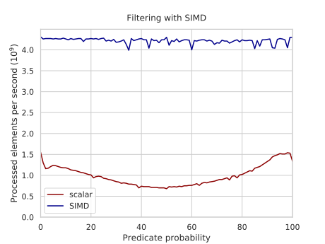

# 16. SIMD: маски, перестановки и сбор данных

!!! warning "WIP"
    Материал в работе: текст и задания могут меняться.

Сложить два вектора просто. Трудности начинаются, когда в коде есть `if`, поиск или фильтрация: у разных полос разные ветки. В SIMD ветвлений нет - есть маски. Здесь мы учимся переводить условия на язык масок, а данные переставлять внутри регистра.

## Сравнение дает маску

```text
 a     = | 5 | 1 | 9 | 3 | 7 | 2 | 8 | 4 |
 x     = | 4 | 4 | 4 | 4 | 4 | 4 | 4 | 4 |
 a > x = |FF |00 |FF |00 |FF |00 |FF |00 |   все единицы или все нули в полосе
 movemask -> 0b01010101 = 0x55              по биту на полосу в обычный регистр
```

```c
__m256i m  = _mm256_cmpgt_epi32(a, x);
int bits   = _mm256_movemask_ps(_mm256_castsi256_ps(m));   // 8 бит
int count  = __builtin_popcount(bits);                     // сколько a[i] > x
int first  = __builtin_ctz(bits);                          // первый (если bits != 0)
```

Отсюда сразу: `count_if` - popcount масок; `find` - первый ненулевой `movemask`, затем `ctz`.

## Blend: выбор по маске

```c
__m256 r = _mm256_blendv_ps(a, b, mask);   // r[i] = mask[i] ? b[i] : a[i]
```

Это `cmov` для векторов (модуль 7). Обе "ветки" вычисляются, маска выбирает результат. Частные случаи проще: `min`, `max`, `and` с маской (обнулить полосы).

## Маски в AVX-512

Отдельные регистры масок `k0`-`k7`, почти любая операция принимает маску:

```c
__mmask16 k = _mm512_cmplt_ps_mask(a, x);
__m512 r = _mm512_mask_add_ps(src, k, a, b);     // складываем только где k = 1
_mm512_mask_compressstoreu_ps(out, k, a);        // фильтр: записать подряд выбранные
```

Хвост цикла тоже обрабатывается маской - без скалярного остатка.

## Перестановки

```text
 ymm = | полоса 128 бит (A) | полоса 128 бит (B) |
         0  1  2  3            4  5  6  7

 _mm256_shuffle_epi32     - переставляет внутри каждой 128-битной половины
 _mm256_permutevar8x32_*  - через границу половин (дороже по латентности)
 _mm256_shuffle_epi8      - таблица из 16 байт внутри половины (pshufb)
```

Многие AVX2-инструкции работают "по половинам" - наследие SSE. Это частая причина неожиданных результатов.

`pshufb` как таблица поиска: 16 значений по 4-битному индексу за одну инструкцию. На этом построены быстрые парсеры (simdjson) и подсчет бит.

## Фильтрация на AVX2

Нет `compress` - используем таблицу перестановок:

<figure class="figure" markdown="1">

<figcaption>Фильтрация без compress: маска, таблица перестановок и permutevar8x32. Источник: Algorithmica (S. Slotin), en.algorithmica.org/hpc/simd/shuffling.</figcaption>
</figure>

## Argmin

Скалярно: сравнение + условное обновление индекса - цепочка зависимостей. Варианты на SIMD:

1. Два прохода: найти минимум (`_mm256_min_epi32` - редукция), затем найти его индекс (`cmpeq` + `movemask` + `ctz`). Просто и упирается в пропускную способность памяти.
2. Один проход: вектор текущих минимумов и вектор индексов, обновление через `blend`. В конце - редукция по 8 полосам.
3. По блокам: считать минимум блока, а точный индекс искать, только когда минимум обновился (редкое событие на случайных данных).

## Векторы переменной длины

До сих пор ширина вектора была вшита в программу: SSE - 128 бит, AVX2 - 256, AVX-512 - 512. В RISC-V Vector (RVV) и ARM SVE ширина не фиксирована: процессор сообщает ее во время выполнения, а код под нее подстраивается.

Функция на C, из которой получается этот цикл:

```c
#include <stdint.h>

void sum_vec(const int32_t *a, long n, int32_t *out) {
    int32_t s = 0;
    for (long i = 0; i < n; i++)
        s += a[i];
    *out = s;
}
```

Соберите с `riscv64-linux-gnu-gcc -O3 -march=rv64gcv`; ниже - схема автовекторизованного цикла, точный вывод зависит от версии GCC.

```asm
# RVV: vsetvli выбирает длину вектора под цикл
loop:
    vsetvli t0, a1, e32, m1   # t0 = сколько элементов влезет
    vle32.v v0, (a0)          # загрузить вектор
    vadd.vv v2, v2, v0        # сложить с аккумулятором
    sub     a1, a1, t0
    add     a0, a0, t0
    bnez    a1, loop
```

Один и тот же бинарник работает при любой VLEN - от 128 до 1024 бит и больше. Цикл без отдельного хвоста называется **strip-mining**: на каждой итерации `vsetvli` выбирает столько элементов, сколько влезает.

Обратная сторона: сумма `float` зависит от порядка сложения, а порядок зависит от VLEN. При VLEN = 128, 256 и 512 битах результат может отличаться в последних битах. Для воспроизводимости нужен фиксированный порядок суммирования, а не "как получится".

ARM: NEON - фиксированные 128 бит, SVE - переменная длина, как RVV.

## Итоги

- Сравнение в SIMD дает маску, а не 0/1; маска выбирает между значениями и считает подходящие элементы.
- `movemask` + `popcount` дают число подходящих без ветвлений.
- Перестановки позволяют сжимать данные внутри регистра, но стоят дороже простого blend.
- В AVX-512 маски стали полноценными регистрами, и код упростился.

## Что почитать

- G. Langdale, D. Lemire, Parsing Gigabytes of JSON per Second, 2019.

---

Задание к модулю: [Маски, перестановки и сбор данных](../tasks/16-simd-masks.md).
