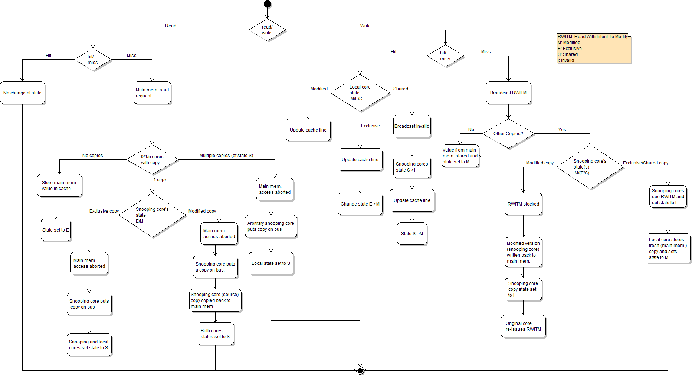
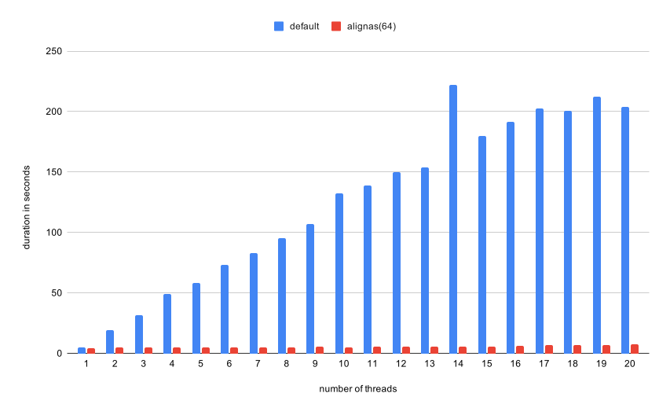

# 18. Потоки и синхронизация

!!! warning "WIP"
    Материал в работе: текст и задания могут меняться.

Последний множитель - число ядер. Он же самый коварный: ядра делят память, кэш L3 и пропускную способность, а согласование кэшей между ними стоит дорого. Код, который на одном ядре был идеален, на 16 ядрах может не ускориться вообще. Этот модуль - про то, когда параллелить имеет смысл и как не помешать самим себе.

## Закон Амдала

Доля $f$ программы параллелится, $1 - f$ - нет:

$$
S(p) = \frac{1}{(1 - f) + f / p}, \qquad S(\infty) = \frac{1}{1 - f}
$$

При $f = 0.95$: $S(16) \approx 9.1$, $S(\infty) = 20$.

Закон Густафсона (растет задача, а не число ядер на ту же задачу):

$$
S(p) = (1 - f) + f \cdot p
$$

Эффективность: $E = S(p) / p$.

## Закон Густафсона

Амдал отвечает на вопрос "что будет, если ускорить ту же задачу". Густафсон - на другой: "что будет, если увеличить задачу под большее число ядер". Если доля последовательной части $s$, то при $p$ процессорах на задаче, выросшей в $p$ раз, ускорение

$$
S_G = s + p(1 - s)
$$

Например, при $s = 0.1$ и $p = 16$: Амдал дает $1 / (0.1 + 0.9/16) \approx 6.4$, а Густафсон - $0.1 + 16 \cdot 0.9 = 14.5$. Разница в том, что Амдал - про **strong scaling** (фиксированный размер), Густафсон - про **weak scaling** (растущий размер).

## Потоки, ядра, SMT

- Поток ОС выполняется на логическом ядре.
- SMT (Hyper-Threading): два логических ядра на одном физическом делят порты, кэши L1/L2. Помогает коду, который часто ждет память; почти не помогает коду, который уже загрузил FMA-блоки.
- `lscpu`: `Thread(s) per core`, `Core(s) per socket`, NUMA-узлы.

## NUMA и привязка потоков

На многопроцессорных машинах память физически привязана к сокетам (NUMA): обращение к "своей" памяти дешевле, к чужой - дороже. По умолчанию память выделяется на том узле, который первым к ней обратился (first-touch), поэтому важно, какой поток ее трогает.

Что делать:

- привязывать потоки к ядрам: `OMP_PROC_BIND=close`, `OMP_PLACES=cores`, `taskset -c 0-7`;
- размещать данные на нужном узле: `numactl --localalloc`, `--interleave`, `mbind`, `numa_alloc_onnode`;
- мерить: `numactl -H`, `perf stat -e node-load-misses` (если есть).

На ноутбуке NUMA обычно нет, а на двухсокетном сервере неправильная привязка может съесть половину ускорения.

## Когерентность кэшей: MESI

Каждая линия в каждом кэше в одном из состояний:

<figure class="figure" markdown="1">
{ width="820" }
<figcaption>Состояния MESI и переходы между ними при чтении и записи. Источник: Jackbrear, Wikimedia Commons, CC0.</figcaption>
</figure>

Передача линии между ядрами - десятки-сотни тактов. Если два ядра по очереди пишут одну линию, она "летает" между ними на каждой записи.

## False sharing

```c
struct { long count; } counters[NTHREADS];   // соседние счетчики в одной линии

// поток t:
for (...) counters[t].count++;               // логически независимы, физически - нет
```

<figure class="figure" markdown="1">
{ width="720" }
<figcaption>Масштабирование счётчиков по потокам: без выравнивания и с выравниванием каждого счётчика на кэш-линию. Источник: Vibrant franklin, Wikimedia Commons, CC0.</figcaption>
</figure>

Лечение: выравнивание по линии.

```c
struct padded { _Alignas(64) long count; };        // C11; в C23 можно alignas(64)
struct alignas(64) padded_cpp { long count; };     // C++
```

`sizeof(struct padded)` станет 64: каждый счетчик в своей линии.

Или копить в локальной переменной и записать один раз в конце.

## Атомики и порядок памяти (кратко)

- x86: префикс `lock` (`lock xadd`), модель TSO - почти последовательная.
- RISC-V: расширение A: `lr`/`sc` и `amoadd` и др.; модель RVWMO - слабая, нужны `fence`.
- В C/C++: `_Atomic` / `std::atomic` с `memory_order` - компилятор вставит нужные барьеры для каждой ISA.

## Стоимость блокировки

Неконфликтный `mutex` стоит десятки тактов (атомарная операция плюс ветвление). Конфликтный - сотни и тысячи: линия кэша с флагом переходит между ядрами, а при долгом ожидании поток уходит в ядро (futex) и просыпается через системный вызов.

- `pthread_mutex`/`std::mutex` - универсально, но дорого при конкуренции;
- спинлок - дешевле на коротких критических секциях, но жжет такты;
- атомарный счетчик - еще дешевле, если операция сводится к `fetch_add`.

Правило: сначала уменьшить число обращений к общему состоянию, потом выбирать примитив.

## Lock-free кольцевой буфер

Очередь "один производитель - один потребитель" можно сделать без блокировок: два индекса, `head` и `tail`, и атомарные операции с правильным порядком памяти (нужен `<stdatomic.h>`).

```c
typedef struct {
    _Atomic size_t head, tail;
    int *buf;
    size_t cap;              /* степень двойки */
} spsc;

int spsc_push(spsc *q, int x) {
    size_t t = atomic_load_explicit(&q->tail, memory_order_relaxed);
    size_t h = atomic_load_explicit(&q->head, memory_order_acquire);
    if (t - h == q->cap) return -1;
    q->buf[t & (q->cap - 1)] = x;
    atomic_store_explicit(&q->tail, t + 1, memory_order_release);
    return 0;
}

int spsc_pop(spsc *q, int *x) {
    size_t h = atomic_load_explicit(&q->head, memory_order_relaxed);
    size_t t = atomic_load_explicit(&q->tail, memory_order_acquire);
    if (h == t) return -1;
    *x = q->buf[h & (q->cap - 1)];
    atomic_store_explicit(&q->head, h + 1, memory_order_release);
    return 0;
}
```

Порядок `acquire`/`release` гарантирует, что данные видны до обновления индекса. Для нескольких производителей нужны CAS-циклы, и очередь заметно усложняется.

## Work stealing

В task-based параллелизме задачи не делят данные заранее, а воруют работу друг у друга. У каждого потока своя deque: он кладет задачи в голову и берет оттуда же (LIFO - горячие данные в кэше), а другие потоки воруют с хвоста (FIFO - старые, крупные задачи). Такой балансировщик используется в TBB, Rust rayon, Go и Java ForkJoin.

Стоимость кражи - синхронизация deque; поэтому задачи должны быть достаточно крупными, чтобы кража окупалась.

## OpenMP

```c
#pragma omp parallel for reduction(+:s) schedule(static)
for (long i = 0; i < n; i++)
    s += a[i];
```

```bash
gcc -O3 -fopenmp f.c
OMP_NUM_THREADS=8 OMP_PROC_BIND=close OMP_PLACES=cores ./a.out
```

- `schedule(static)` - равные куски, `dynamic` - для неравной работы.
- Привязка потоков к ядрам уменьшает разброс замеров.

## Что не масштабируется

- Код, ограниченный памятью: пропускная способность DRAM общая. Сумма массива перестает ускоряться на нескольких ядрах.
- Код с общей записью (счетчики, очереди с блокировкой).
- Маленькие задачи: создание потоков и синхронизация дороже работы.

Плюс воспроизводимость: параллельная `reduction` для float складывает в другом порядке - результат меняется от числа потоков.

## Итоги

- Закон Амдала ограничивает ускорение последовательной частью.
- Когерентность кэшей (MESI) делает запись в общую линию дорогой; false sharing - частая причина странного замедления.
- OpenMP берет на себя потоки и редукции, но не отменяет законы памяти.
- Масштабируется не только код: память и синхронизация тоже делятся между потоками.
- Густафсон показывает выигрыш на растущей задаче (weak scaling), Амдал - на фиксированной.
- На NUMA-машине важно, где лежат данные и к каким ядрам привязаны потоки.
- Конфликтный мьютекс дорог; для одного производителя и потребителя хватает lock-free ring buffer.
- Work stealing балансирует задачи без ручного деления данных.

## Что почитать

- P. McKenney, [Is Parallel Programming Hard...](https://kernel.org/pub/linux/kernel/people/paulmck/perfbook/perfbook.html), главы о счетчиках и о железе.
- G. Amdahl, Validity of the Single Processor Approach to Achieving Large Scale Computing Capabilities, 1967.

---

Задание к модулю: [Потоки, синхронизация и NUMA](../tasks/18-threads.md).
