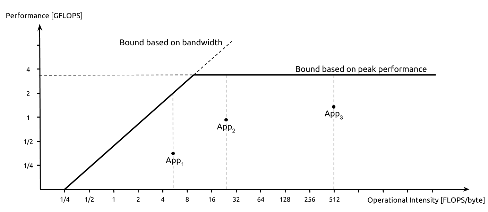
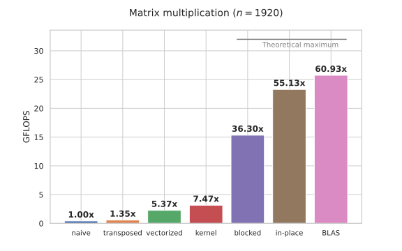

# 19. Roofline и как устроен BLAS

!!! warning "WIP"
    Материал в работе: текст и задания могут меняться.

Все, что было в курсе, сходится в одной задаче. Наивное умножение $1920 \times 1920$ работает около 0.4 GFLOPS. Версия на 40 строк C с блочностью, SIMD-микроядром и FMA подходит к пику ядра и к BLAS. Этот модуль - про то, как оценить, далеко ли мы от пика, и как устроены библиотеки уровня BLAS.

## Где мы относительно пика

$$
P_{peak} = N_{cores} \cdot f \cdot N_{FMA} \cdot W \cdot 2
$$

Пример: одно ядро, 3 ГГц, 2 FMA, AVX2 (8 float): 96 GFLOPS.

## Roofline

Арифметическая интенсивность GEMM при идеальном переиспользовании:

$$
I = \frac{2 n^3}{3 n^2 \cdot 4 \text{ Б}} = \frac{n}{6}\ \text{FLOP/Б}, \qquad
n = 1920:\ I = 320
$$

Задача может упираться в вычисления, но только если данные действительно переиспользуются из кэша. Наивная версия читает из памяти намного больше и сидит под наклонной частью:

<figure class="figure" markdown="1">
{ width="820" }
<figcaption>Roofline-модель: наклонная часть - пропускная способность памяти, горизонтальная - пик вычислений. Источник: Giu.natale, Wikimedia Commons, CC BY-SA 4.0.</figcaption>
</figure>

## Как устроен BLAS (Goto, van de Geijn)

```text
 for jc  (блоки столбцов по L3)
   for pc  (блоки по k, упаковать B в непрерывный буфер)
     for ic  (блоки строк по L2, упаковать A)
       for jr  (по ширине микроядра)
         for ir  (по высоте микроядра)
           микроядро: блок C, например 6 x 16, целиком в регистрах,
                      k шагов FMA
```

- Микроядро держит блок C в регистрах: на каждую загрузку - много FMA.
- Упаковка делает обращения последовательными и выровненными.
- Размеры блоков подбираются под L1, L2, L3 конкретного CPU.

Идея блочного алгоритма в том, чтобы каждое обращение к памяти окупалось большим числом FMA. Микроядро держит блок результата в регистрах, а упаковка переставляет данные так, чтобы загрузки шли последовательно и попадали в кэш-линии целиком. Размеры блоков подбираются под три уровня кэша: внешний - под L3, средний - под L2, микроядро - под L1.

Поэтому BLAS почти не зависит от языка: узкое место - не выражения, а порядок обращений к памяти и планирование регистров. Одна и та же формула, записанная с блоками и упаковкой, дает в десятки раз больше GFLOPS, чем та же формула в трех циклах.

<figure class="figure" markdown="1">

<figcaption>Сравнение оптимизированных версий умножения матриц с BLAS. Источник: Algorithmica (S. Slotin), en.algorithmica.org/hpc/algorithms/matmul.</figcaption>
</figure>

## Итоги

- Пик ядра считается из частоты, числа FMA и ширины вектора.
- Roofline показывает, упирается задача в вычисления или в память; для GEMM интенсивность равна $n/6$.
- BLAS раскладывает задачу на блоки под L1, L2 и L3 и держит блок результата в регистрах.
- Все приемы курса - память, SIMD, ILP, потоки - сходятся в одной задаче и объясняются одними и теми же числами.

## Что почитать

- Статья: K. Goto, R. van de Geijn, Anatomy of High-Performance Matrix Multiplication, 2008.
- S. Williams, A. Waterman, D. Patterson, Roofline: An Insightful Visual Performance Model for Multicore Architectures, 2009.

---

Задание к модулю: [GEMM и roofline](../tasks/19-gemm.md).
